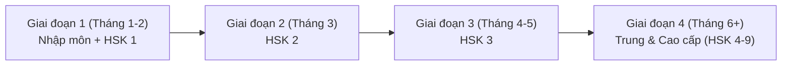

# THIẾT KẾ CHƯƠNG TRÌNH HỌC TIẾNG TRUNG CHO NGƯỜI VIỆT TỰ HỌC
> **Căn cứ chuẩn:** HSK 3.0 (*GF0025-2021* - 3 bậc 9 cấp) & Phương pháp Micro-learning tích hợp Spaced Repetition (SRS SM-2)  
> **Nền tảng mục tiêu:** Web ứng dụng tự học tiếng Trung tương tác cao dành riêng cho người Việt

---

## 1. TRIẾT LÝ & NGUYÊN TẮC THIẾT KẾ

### 1.1. Triết lý đào tạo: "Tận dụng lợi thế - Triệt tiêu tử huyệt"
Người Việt học tiếng Trung có lợi thế địa văn hóa và ngôn ngữ lớn nhất thế giới, nhưng cũng đối mặt với những bẫy tâm lý và thói quen phát âm cố hữu:
1. **Đòn bẩy Hán-Việt (>60% từ vựng tương đồng):** 
   - Không học chữ Hán như người phương Tây (vốn coi chữ Hán là ký tự trừu tượng). Mỗi chữ Hán đều gắn liền với một **Âm Hán-Việt**, tạo chuỗi liên tưởng "Họ từ" (*word family*). Học một chữ hiểu mười từ (ví dụ: học `学` [học] $\rightarrow$ liên kết ngay `学生` [học sinh], `大学` [đại học], `学习` [học tập], `留学` [du học]).
2. **Cảnh báo và giải trừ "Bẫy Hán-Việt" (*False Friends*):**
   - Sự trôi dạt ngữ nghĩa qua hàng ngàn năm khiến nhiều từ Hán-Việt đồng âm nhưng khác nghĩa, hoặc lệch sắc thái nghiêm trọng (như `困难` là khó khăn chứ không mang nghĩa chửi tục; `爱人` là vợ/chồng chứ không phải bồ nhí; `手段` là phương pháp trung tính chứ không phải thủ đoạn nham hiểm). Chương trình bố trí các bài học chuyên đề bẫy Hán-Việt để người học không mắc sai lầm giao tiếp.
3. **Đột phá ngữ âm đặc thù:**
   - Người Việt dễ phát âm đúng thanh điệu cơ bản nhưng hay mắc lỗi ở: **Âm bật hơi** ($p, t, k, q, ch, c$), **Phân biệt âm mặt lưỡi vs uốn lưỡi** ($j, q, x$ vs $zh, ch, sh, r$ vs $z, c, s$), **Nguyên âm tròn môi** ($\ddot{u}$) và đặc biệt là **Thanh 4** (cao độ giáng dứt khoát $5 \rightarrow 1$, người Việt hay đọc thành thanh huyền hoặc sắc nhẹ). Chương trình thiết kế công cụ trực quan hóa cao độ thanh điệu (*pitch contour*) và bài tập đối kháng cặp âm.
4. **Khắc phục trật tự ngữ pháp ngược tiếng Việt:**
   - Tiếng Việt đặt định ngữ và trạng ngữ sau danh từ/động từ chính, trong khi tiếng Trung đặt trước:
     - *Định ngữ + 的 + Trung tâm ngữ:* `漂亮的姑娘` (Cô gái đẹp - tính từ đứng trước).
     - *Trạng ngữ thời gian / nơi chốn trước động từ:* `我在图书馆看书` (Tôi ở thư viện đọc sách - nơi chốn đứng trước).
     - *Bắt buộc dùng lượng từ phù hợp:* `一个人`, `三本书`, `两张票`.

### 1.2. Nguyên tắc bài giảng Micro-learning (12 – 15 phút/bài)
- **Chia nhỏ tri thức:** Mỗi bài chỉ tải nạp 8 – 15 từ mới và 1 – 2 điểm ngữ pháp trọng tâm.
- **Vòng lặp ghi nhớ SM-2:** Từ vựng mới học sẽ tự động đồng bộ vào thuật toán lặp lại ngắt quãng (SRS), đảm bảo ôn đúng "thời điểm vàng" trước khi quên.
- **Tiêu chuẩn hoàn thành nghiêm ngặt (Mastery Learning):** Cuối mỗi chương có bài kiểm tra chặng, người học phải đạt $\ge 80\%$ điểm số mới được mở khóa chương kế tiếp. Cuối mỗi cấp có bài thi thử mô phỏng 100% định dạng đề HSK 3.0 chính thức.

---

## 2. BẢNG TỔNG HỢP CÁC CẤP ĐỘ THEO CHUẨN HSK 3.0

> **Ghi chú tính thời lượng:** Tính theo thói quen học tập bền vững của người đi làm/học sinh: **20 phút/ngày** (bao gồm học bài mới và ôn thẻ SRS). 1 giờ học tương đương 3 ngày học 20 phút.

| Cấp | Bậc | Tên cấp | Tương đương CEFR | Âm tiết *(mới / lũy kế)* | Chữ Hán *(mới / lũy kế)* | Từ vựng *(mới / lũy kế)* | Ngữ pháp *(mới / lũy kế)* | Viết tay *(lũy kế)* | Giờ học ước tính | Thời gian học (20p/ngày) | Cấu trúc chương trình |
| :---: | :---: | :--- | :---: | :---: | :---: | :---: | :---: | :---: | :---: | :---: | :--- |
| **0** | **Nhập môn** | Khởi động ngữ âm & Nét chữ | Pre-A1 | 269 / 269 | 100 / 100 | 80 / 80 | 10 / 10 | 50 chữ | 20 giờ | 2 tháng (60 ngày) | 2 chương x 5 bài = 10 bài |
| **1** | **Sơ cấp** | HSK 1 | Pre-A1 / Entry A1 | 269 / 269 | 300 / 300 | 500 / 500 | 48 / 48 | 100 chữ | 80 – 100 giờ | 8 – 10 tháng (~270 ngày) | 6 chương x 5 bài = 30 bài |
| **2** | **Sơ cấp** | HSK 2 | A1 | 199 / 468 | 300 / 600 | 772 / 1.272 | 81 / 129 | 200 chữ | 100 – 120 giờ | 10 – 12 tháng (~330 ngày) | 8 chương x 5 bài = 40 bài |
| **3** | **Sơ cấp** | HSK 3 | A2 | 140 / 608 | 300 / 900 | 973 / 2.245 | 81 / 210 | 300 chữ | 140 – 180 giờ | 14 – 18 tháng (~480 ngày) | 10 chương x 5 bài = 50 bài |
| **4** | **Trung cấp** | HSK 4 | B1 | 116 / 724 | 300 / 1.200 | 1.000 / 3.245 | 76 / 286 | 400 chữ | 200 – 250 giờ | 20 – 25 tháng (~675 ngày) | 12 chương x 5 bài = 60 bài |
| **5** | **Trung cấp** | HSK 5 | B2 | 98 / 822 | 300 / 1.500 | 1.071 / 4.316 | 71 / 357 | 600 chữ | 250 – 300 giờ | 25 – 30 tháng (~825 ngày) | 12 chương x 5 bài = 60 bài |
| **6** | **Trung cấp** | HSK 6 | C1 | 86 / 908 | 300 / 1.800 | 1.140 / 5.456 | 67 / 424 | 800 chữ | 350 – 400 giờ | 35 – 40 tháng (~1.100 ngày) | 12 chương x 5 bài = 60 bài |
| **7-9** | **Cao cấp** | HSK 7–9 | C1+ đến C2 | 202 / 1.110 | 1.200 / 3.000 | 5.636 / 11.092 | 148 / 572 | 1.200 chữ | 800 – 1.000+ giờ | 80 – 100+ tháng (Dài hạn) | 15 mô-đun chuyên đề |

### Mục tiêu năng lực chi tiết từng cấp:
- **Cấp 0 (Nhập môn):** Đọc chuẩn toàn bộ 21 thanh mẫu, 36 vận mẫu, 4 thanh điệu; nhận diện và viết đúng 8 nét cơ bản, 10 bộ thủ phổ biến nhất; biết quy tắc gõ chữ Hán Pinyin trên máy tính/điện thoại.
- **HSK 1:** Giao tiếp những tình huống sinh hoạt cơ bản nhất (chào hỏi, mua sắm đơn giản, hỏi giờ, hỏi đường); hiểu thông báo cực ngắn; viết câu đơn giản (tốc độ viết tay $\sim 10$ chữ/phút).
- **HSK 2:** Giao tiếp trôi chảy các chủ đề đời sống quen thuộc (thời tiết, ăn uống, phương tiện đi lại, thuê phòng, cảm xúc); đọc hiểu tin nhắn, thực đơn, bảng chỉ dẫn; viết đoạn văn ngắn 50–80 chữ.
- **HSK 3:** Tự tin du lịch độc lập, trao đổi trong học tập và công việc hàng ngày; đọc hiểu email, mẩu tin ngắn; viết đoạn văn biểu đạt cảm xúc, kể chuyện 100–150 chữ (viết tay 20 chữ/phút).
- **HSK 4:** Thảo luận công việc văn phòng, tin tức xã hội, văn hóa đời sống; bắt đầu rèn luyện **kỹ năng khẩu dịch và bút dịch cơ bản** (dịch thông báo ngắn, dịch câu hội thoại hai chiều Trung - Việt).
- **HSK 5:** Đọc hiểu báo chí mạng, thưởng thức phim ảnh không cần phụ đề; diễn thuyết lưu loát về chủ đề chuyên ngành; **khẩu dịch/bút dịch bán chuyên** văn bản hành chính, email thương mại.
- **HSK 6:** Đọc tác phẩm văn học, hiểu các bài nói chuyện học thuật chuyên sâu; viết bài luận logic sắc bén; **dịch thuật trôi chảy 2 chiều Trung - Việt** các chủ đề xã hội, văn bản hợp đồng.
- **HSK 7–9:** Làm chủ ngôn ngữ ở cấp độ bản ngữ học thuật/ngoại giao; **yêu cầu dịch thuật chuyên nghiệp 2 chiều:** Bút dịch văn bản luật pháp, tài chính, khoa học kỹ thuật và Khẩu dịch hội nghị, cabin song song.

### Quy chuẩn hiển thị Pinyin theo cấp:
- **Nhập môn – HSK 2:** Mặc định **luôn hiện Pinyin** trên chữ Hán (có nút bấm Bật/Tắt Pinyin để người học tự thử thách khả năng nhận diện chữ).
- **HSK 3:** Mặc định **ẩn Pinyin đối với những chữ Hán đã học** ở các bài trước; chỉ hiện Pinyin với từ mới xuất hiện lần đầu trong bài.
- **HSK 4 trở lên:** Mặc định **hoàn toàn ẩn Pinyin** (mô phỏng văn bản thực tế). Người học chỉ có thể xem Pinyin và nghĩa khi chạm/hover vào chữ Hán đó.

---

## 3. MẪU BÀI HỌC, ÔN CHƯƠNG, KIỂM TRA CHẶNG & THI THỬ

### 3.1. Mẫu cấu trúc 1 bài học chuẩn (6 bước - 12 đến 15 phút)

```
[BƯỚC 1] Khởi động SRS (2') ──► [BƯỚC 2] Từ mới & Hán-Việt (3') ──► [BƯỚC 3] Ngữ pháp cốt lõi (2')
                                                                                   │
[BƯỚC 6] Tổng kết & Thẻ SRS (1') ◄── [BƯỚC 5] Luyện tập tương tác (4') ◄── [BƯỚC 4] Bài khóa & Nghe (3')
```

1. **Bước 1: Khởi động (2 phút) - [Tích hợp: Thẻ ghi nhớ SM-2]**
   - Tự động lấy ra 5–10 thẻ từ vựng cũ đã đến hạn ôn (*due cards*) theo thuật toán SM-2.
   - Ôn nhanh phản xạ: Chữ Hán $\rightarrow$ Nhớ âm Hán-Việt, Pinyin, nghĩa tiếng Việt.
2. **Bước 2: Từ mới (3 phút) - [Tích hợp: Từ vựng & Chữ viết]**
   - Nạp 8–15 từ mới của bài.
   - Mỗi chữ Hán hiển thị đầy đủ: Chữ Hán giản thể, Pinyin chuẩn thanh điệu, **Âm Hán-Việt in đậm**, Phân tích chiết tự bộ thủ, Ảnh động thứ tự nét viết tay (*stroke order*), 1 câu ví dụ mẫu.
   - Nêu ngay "Họ từ Hán-Việt" nếu có chữ Hán mang tính gốc.
3. **Bước 3: Ngữ pháp (2 phút) - [MỤC MỚI: Ngữ pháp tương tác]**
   - Giảng giải 1–2 điểm ngữ pháp với công thức trực quan đóng khung.
   - 3 ví dụ thực tế có audio người bản xứ đọc.
   - **Hộp chú thích đối chiếu Việt - Trung:** Nêu rõ chỗ ngữ pháp tiếng Trung ngược với tư duy tiếng Việt để người học không bị dịch word-by-word.
4. **Bước 4: Bài khóa & Nghe hiểu (3 phút) - [Tích hợp: Hội thoại]**
   - Đoạn hội thoại tự nhiên hoặc đoạn văn ngắn (4–8 câu) lồng ghép toàn bộ từ mới và ngữ pháp vừa học.
   - Có audio đọc với 2 chế độ tốc độ: 0.8x (chậm rõ) và 1.0x (bản xứ).
   - Nút chuyển đổi: Ẩn/Hiện Pinyin, Dịch nghĩa tiếng Việt từng câu.
5. **Bước 5: Luyện tập đa giác quan (4 phút) - [Tích hợp bài tập tương tác]**
   - Học viên vượt qua 4–6 thử thách ngẫu nhiên từ kho bài tập:
     - *Nghĩa $\leftrightarrow$ Chữ:* Trắc nghiệm chọn chữ Hán theo nghĩa hoặc chọn nghĩa theo chữ.
     - *Nghe chọn đáp án:* Nghe âm phát ra, chọn chữ Hán/Pinyin chuẩn.
     - *Ghép câu kéo thả [MỚI]:* Kéo thả các khối từ Hán để tạo thành câu hoàn chỉnh đúng trật tự ngữ pháp (đặc biệt các câu đảo vị trí trạng ngữ/định ngữ).
     - *Luyện gõ Pinyin [Luyện gõ]:* Gõ pinyin trên bàn phím ảo/thật để máy xuất ra chữ Hán đúng.
     - *Tập viết mô phỏng [Chữ viết]:* Dùng ngón tay/chuột tô đúng thứ tự nét chữ Hán.
     - *Phân biệt ngữ âm [Phát âm]:* Phân biệt cặp âm bật hơi ($t/d, p/b, q/j$) hoặc thanh 4 vs thanh 1.
6. **Bước 6: Tổng kết & Đồng bộ SRS (1 phút)**
   - Chấm điểm bài học: Đạt từ 1 đến 3 Sao vàng, tặng điểm kinh nghiệm XP.
   - Tự động nạp toàn bộ từ mới của bài vào hàng đợi ôn tập Spaced Repetition (SRS) cho những ngày tiếp theo.

---

### 3.2. Mẫu Ôn chương, Kiểm tra chặng & Thi thử cuối cấp

#### A. Ôn chương (*Unit Review*)
- Bố cục ở bài cuối của mỗi chương (Unit).
- Tổng hợp bảng tra nhanh từ vựng của cả chương, sơ đồ tư duy liên kết ngữ pháp, và danh sách các "Bẫy Hán-Việt" đã gặp trong chương.
- Luyện tập tổng hợp: 10 câu trắc nghiệm bao quát từ vựng và cấu trúc ngữ pháp cả chương.

#### B. Kiểm tra chặng (*Checkpoint Test*)
- **Điều kiện vượt ải:** Bắt buộc đạt $\ge 80\%$ điểm số (ví dụ: đúng ít nhất 16/20 câu) mới mở khóa chương tiếp theo.
- **Thời lượng:** 15 – 20 phút (20 câu hỏi tính giờ).
- **Cấu trúc đề:**
  - Phần 1: Nghe hiểu (5 câu) - Nghe câu chọn ảnh/chữ Hán tương ứng.
  - Phần 2: Đọc hiểu (10 câu) - Điền từ vào chỗ trống, chọn đáp án đúng ngữ pháp, sắp xếp câu.
  - Phần 3: Ứng dụng Hán-Việt (5 câu) - Nhận diện âm Hán-Việt và tránh bẫy ngữ nghĩa.
- **Cơ chế thi lại:** Nếu dưới 80%, hệ thống chỉ ra chính xác các câu sai, đưa các từ bị lỗi vào **"Sổ tay từ khó"** và yêu cầu ôn lại trước khi thi lại sau tối thiểu 1 giờ.

#### C. Thi thử cuối cấp (*Mock Test*)
- Mô phỏng 100% định dạng đề thi thật HSK 3.0 của CTI (*Chinese Testing International*):
  - **HSK 1 Mock Test:** 40 câu / 35 phút (Nghe 20 câu 15 phút + Đọc 20 câu 17 phút + 3 phút điền thông tin). Thang điểm 200 (Đạt: $\ge 120$).
  - **HSK 2 Mock Test:** 60 câu / 50 phút (Nghe 35 câu 25 phút + Đọc 25 câu 22 phút). Thang điểm 200 (Đạt: $\ge 120$).
  - **HSK 3 Mock Test:** 80 câu / 85 phút (Nghe 40 câu 35 phút + Đọc 30 câu 30 phút + Viết 10 câu 15 phút). Thang điểm 300 (Đạt: $\ge 180$).
- Bảng phân tích năng lực chi tiết sau thi: Radar chart thể hiện điểm mạnh/yếu theo từng kỹ năng; cấp chứng nhận điện tử của website để chia sẻ.

---

## 4. LỘ TRÌNH HỌC CHI TIẾT ĐẾN TỪNG BÀI

### 4.1. CẤP 0: NHẬP MÔN (2 chương x 5 bài = 10 bài)

#### Chương 0.1: Khởi động Phát âm Pinyin & Thanh điệu (5 bài)
*Mục tiêu:* Nắm vững 21 thanh mẫu, 36 vận mẫu, 4 thanh điệu chính và 1 thanh nhẹ; đọc chính xác không ngọng các âm khó đối với người Việt.

- **Bài 0.1.1: 6 Vận mẫu đơn & 4 Thanh điệu căn bản**
  - *Mục tiêu:* Phát âm đúng $a, o, e, i, u, \ddot{u}$; nắm chắc 4 thanh điệu; đặc biệt làm chủ **Thanh 4 (51)** dứt khoát và **Thanh 3 (214)** võng sâu.
  - *Từ mới (5 chữ/từ):* 啊, 喔, 鹅, 衣, 乌.
  - *Ngữ pháp:* Khái niệm âm tiết tiếng Trung (Thanh mẫu + Vận mẫu + Thanh điệu).
  - *Trọng tâm ngữ âm/chữ:* Biểu đồ cao độ thanh điệu (Pitch Contour); phân biệt Thanh 1 ($55$ bằng bổng) và Thanh 4 ($51$ rơi dứt khoát, không phải dấu huyền tiếng Việt).
  - *Bài khóa (1 dòng):* 妈妈骑马，马慢，妈妈骂马。(Mẹ cưỡi ngựa, ngựa chậm, mẹ mắng ngựa).
  - *Dạng bài tập:* Nghe nhận biết thanh điệu, trắc nghiệm cao độ thanh 4, luyện phát âm đơn âm tiết.

- **Bài 0.1.2: Thanh mẫu môi - răng & Phân biệt âm bật hơi**
  - *Mục tiêu:* Làm chủ các âm môi $b, p, m, f$ và đầu lưỡi $d, t, n, l$; triệt tiêu lỗi quên bật hơi cặp $b$ vs $p$, $d$ vs $t$.
  - *Từ mới (5 chữ/từ):* 怕, 发, 爬, 飞, 白.
  - *Ngữ pháp:* Nguyên lý luồng hơi của âm bật hơi (*aspirated sounds*) trong tiếng Trung.
  - *Trọng tâm:* Cặp đối kháng $b$ (không bật hơi) vs $p$ (bật hơi mạnh làm rung tờ giấy trước miệng); $d$ (không bật) vs $t$ (bật hơi).
  - *Bài khóa (1 dòng):* 爸爸怕白兔，大他不怕。(Bố sợ thỏ trắng, to thế ông ấy không sợ).
  - *Dạng bài tập:* Cặp âm đối kháng nghe - chọn ($ba/pa, da/ta$), ghi âm đối chiếu AI, chọn chữ theo pinyin.

- **Bài 0.1.3: Thanh mẫu cuống lưỡi, mặt lưỡi & Quy tắc nguyên âm $\ddot{u}$**
  - *Mục tiêu:* Phát âm chuẩn nhóm cuống lưỡi $g, k, h$ và nhóm mặt lưỡi $j, q, x$; nắm quy tắc bỏ 2 chấm của $\ddot{u}$ khi đi với $j, q, x$.
  - *Từ mới (5 chữ/từ):* 歌, 哭, 渴, 句, 绿.
  - *Ngữ pháp:* Quy tắc viết Pinyin: $j, q, x + \ddot{u} \rightarrow ju, qu, xu$ (bỏ hai dấu chấm trên đầu nhưng vẫn đọc là âm tròn môi $\ddot{u}$).
  - *Trọng tâm:* Âm bật hơi $q$ (mặt lưỡi bật hơi); phân biệt $h$ (âm họng nhẹ xát) với $k$ (cuống lưỡi bật hơi); tròn môi $\ddot{u}$ không bè miệng thành "uy".
  - *Bài khóa (1 dòng):* 哥哥渴了要喝水，去七家商店。(Anh trai khát muốn uống nước, đi bảy cửa hàng).
  - *Dạng bài tập:* Nhận diện quy tắc viết Pinyin, điền thanh mẫu thiếu, trắc nghiệm nghe $j/q/x$.

- **Bài 0.1.4: Phân biệt âm đầu lưỡi phẳng $z, c, s$ và âm uốn lưỡi $zh, ch, sh, r$**
  - *Mục tiêu:* Làm chủ "tử huyệt" phát âm khó nhất của người Việt: phân biệt rạch ròi vị trí lưỡi phẳng răng trước ($z, c, s$) và uốn cong đầu lưỡi vòm họng ($zh, ch, sh, r$).
  - *Từ mới (5 chữ/từ):* 字, 词, 四, 纸, 草.
  - *Ngữ pháp:* Hiện tượng vận mẫu $i$ sau $z, c, s$ và $zh, ch, sh, r$ đọc như âm "ư/ơ" ngậm miệng.
  - *Trọng tâm:* Phân biệt đối kháng $sì$ (bốn - lưỡi phẳng) và $shí$ (mười - uốn lưỡi); âm bật hơi $c$ vs $ch$.
  - *Bài khóa (1 dòng):* 四是四，十是十，十四是十四，四十是四十。(Bốn là bốn, mười là mười...).
  - *Dạng bài tập:* Luyện nói câu líu lưỡi (*tongue twister*), nghe chọn $zh/z$, $ch/c$, $sh/s$, gõ Pinyin.

- **Bài 0.1.5: Vận mẫu phức, vận mẫu mũi & Các quy tắc biến điệu quan trọng**
  - *Mục tiêu:* Đọc trơn các vận mẫu kép và mũi ($an, en, in, un, ang, eng, ing, ong$); nắm vững quy tắc biến điệu hai thanh 3 ($3+3 \rightarrow 2+3$), biến điệu chữ 一 (yī) và chữ 不 (bù).
  - *Từ mới (5 chữ/từ):* 红, 蓝, 黄, 黑, 光.
  - *Ngữ pháp:* **G1-001** (Đại từ nhân xưng); Quy tắc biến điệu hai thanh 3 đi liền nhau; quy tắc biến điệu chữ 不 và 一.
  - *Trọng tâm:* Nói liền mạch cụm từ chào hỏi với thanh điệu biến đổi tự nhiên; thanh nhẹ (*neutral tone*) trong 谢谢, 关系.
  - *Bài khóa (1 dòng):* 你好！我不去，我们一起去，好吗？(Xin chào! Tôi không đi, chúng ta cùng đi nhé?).
  - *Dạng bài tập:* Đánh dấu thanh điệu thực tế khi đọc, chọn phát âm đúng biến điệu, ghép hội thoại chào hỏi.

---

#### Chương 0.2: Nét bút, Bộ thủ & Cấu tạo Chữ Hán (5 bài)
*Mục tiêu:* Nắm vững 8 nét cơ bản, 7 quy tắc bút thuận, 10 bộ thủ gốc; hiểu tư duy chữ hình thanh và biết gõ tiếng Trung trên máy tính/điện thoại.

- **Bài 0.2.1: 8 Nét cơ bản & 7 Quy tắc bút thuận viết chữ Hán**
  - *Mục tiêu:* Nhận diện và viết chuẩn xác 8 nét cơ bản (ngang, sổ, phẩy, mác, hất, chấm, gập, móc); tuân thủ 7 quy tắc bút thuận (trên trước dưới sau, trái trước phải sau, ngoài trước trong sau...).
  - *Từ mới (5 chữ/từ):* 口, 日, 月, 山, 田.
  - *Ngữ pháp:* 7 quy tắc bút thuận cơ bản trong thư pháp và chữ Hán hiện đại.
  - *Trọng tâm:* Phân biệt nét phẩy (丿) và nét mác (乀); viết nét sổ thẳng không run tay.
  - *Bài khóa (1 dòng):* 一二三四五，天上有日月。(Một hai ba bốn năm, trên trời có mặt trời mặt trăng).
  - *Dạng bài tập:* Tập viết nét ảo trên màn hình, sắp xếp thứ tự các nét của chữ Hán, đếm số nét.

- **Bài 0.2.2: 10 Bộ thủ biểu ý đời sống phổ biến nhất**
  - *Mục tiêu:* Nắm chắc hình dạng và ý nghĩa của 10 bộ thủ gốc: Bộ Nhân (人/亻), Khẩu (口), Nữ (女), Thủy (水/氵), Mộc (木), Hỏa (火/灬), Thổ (土), Nhật (日), Nguyệt (月), Tâm (心/忄).
  - *Từ mới (5 chữ/từ):* 木, 火, 土, 金, 水.
  - *Ngữ pháp:* Vai trò biểu ý của bộ thủ trong việc ghi nhớ nghĩa từ vựng.
  - *Trọng tâm:* Cách biến đổi của bộ thủ khi ghép vào chữ (人 $\rightarrow$ 亻, 水 $\rightarrow$ 氵, 火 $\rightarrow$ 灬, 心 $\rightarrow$ 忄).
  - *Bài khóa (1 dòng):* 他喝水，她吃米，大家心里都高兴。(Anh ấy uống nước, cô ấy ăn cơm, lòng mọi người đều vui).
  - *Dạng bài tập:* Ghép bộ thủ với nghĩa tương ứng, tách bộ thủ trong chữ Hán, đoán nghĩa từ lạ dựa vào bộ thủ.

- **Bài 0.2.3: Cấu tạo chữ Hán: Chữ Tượng hình & Hội ý**
  - *Mục tiêu:* Hiểu phương thức tạo chữ của người xưa qua chữ Tượng hình (vẽ vật) và Hội ý (ghép 2 ý nghĩa tạo nghĩa mới); kích hoạt liên tưởng trực quan.
  - *Từ mới (5 chữ/từ):* 休, 林, 森, 目, 门.
  - *Ngữ pháp:* Phương pháp tạo chữ tượng hình và hội ý.
  - *Trọng tâm:* Tận dụng âm Hán-Việt tương đồng: Minh (明), Hảo (好), Hưu (休), Lâm (林), Sâm (森), Khán (看), Hữu (友).
  - *Bài khóa (1 dòng):* 明天好朋友去山林休息。(Ngày mai bạn tốt đi rừng núi nghỉ ngơi).
  - *Dạng bài tập:* Nối các bộ phận tạo thành chữ có nghĩa, giải thích chiết tự chữ Hán, viết lại chữ hội ý.

- **Bài 0.2.4: Chữ Hình thanh & Họ từ Hán-Việt (Chìa khóa học 80% chữ Hán)**
  - *Mục tiêu:* Nắm vững quy tắc chữ Hình thanh (Thành tố Hình chỉ nghĩa + Thành tố Thanh chỉ phát âm); ứng dụng phương pháp "Cây phả hệ họ từ Hán-Việt".
  - *Từ mới (5 chữ/từ):* 抱, 饱, 清, 晴, 情.
  - *Ngữ pháp:* **G1-003** (Trợ từ nghi vấn 吗); Cơ chế tạo chữ hình thanh (thanh bàng + hình bàng).
  - *Trọng tâm:* Quy luật mượn âm trong tiếng Trung và cách người Việt suy luận nhanh hàng trăm chữ mới từ một âm gốc.
  - *Bài khóa (1 dòng):* 今天天气晴，妈妈请大家吃饱。(Hôm nay trời nắng, mẹ mời mọi người ăn no).
  - *Dạng bài tập:* Tìm thành tố mượn âm trong chữ, phân loại từ cùng gốc thanh bàng, trắc nghiệm phát âm chữ hình thanh.

- **Bài 0.2.5: Kỹ năng gõ tiếng Trung Pinyin & Tra từ điển Hán ngữ**
  - *Mục tiêu:* Cài đặt và sử dụng thành thạo bộ gõ Pinyin trên máy tính (Windows/Mac) và điện thoại (Sogou / Gboard); biết cách gõ âm $\ddot{u}$ (bấm phím `v`); biết tra từ điển theo bộ thủ và Pinyin.
  - *Từ mới (5 chữ/từ):* 拼音, 笔画, 部首, 偏旁, 查.
  - *Ngữ pháp:* **G1-027** (Đại từ 怎么 hỏi cách thức); Quy tắc gõ Pinyin.
  - *Trọng tâm:* Kỹ năng chọn đúng chữ Hán đồng âm khi gõ cụm từ; gõ theo cụm thay vì gõ từng chữ đơn lẻ.
  - *Bài khóa (1 dòng):* 我在电脑上用拼音打汉字，查词典学习。(Tôi dùng Pinyin gõ chữ Hán trên máy tính, tra từ điển học tập).
  - *Dạng bài tập:* Luyện gõ phím ảo theo văn bản cho trước, tìm chữ Hán đúng trong danh sách gợi ý, gõ phím chữ có chứa âm $\ddot{u}$.

---

### 4.2. HSK 1: SƠ CẤP 1 (6 chương x 5 bài = 30 bài)
> **Ghi chú từ vựng:** Cần đối chiếu danh sách chính thức HSK 3.0 cấp 1 trước khi phát hành.

#### Chương 1.1: Chào hỏi, Giới thiệu & Quốc tịch (5 bài)
*Mục tiêu:* Chào hỏi xã giao lịch sự; tự giới thiệu họ tên, quốc tịch, nghề nghiệp; làm quen người mới.

- **Bài 1.1.1: Chào hỏi lịch thiệp & Lời cảm ơn, xin lỗi**
  - *Mục tiêu:* Chào hỏi người bằng vai và người lớn tuổi kính cẩn; bày tỏ cảm ơn, xin lỗi và đáp lại.
  - *Từ mới (15 từ):* 你好, 您, 好, 早, 再见, 谢谢, 不, 客气, 对不起, 没关系, 请, 问, 请问, 贵姓, 欢迎.
  - *Ngữ pháp:* **G1-001** (Đại từ nhân xưng); **G1-003** (Trợ từ nghi vấn 吗).
  - *Trọng tâm âm/chữ:* Phân biệt sắc thái 你 vs kính ngữ 您 (thêm bộ Tâm 心 ở dưới); biến điệu thanh nhẹ trong 谢谢, 对不起.
  - *Bài khóa (1 dòng):* — 您好！早上好！ — 您好，很高兴见到您！(— Chào ngài! Chào buổi sáng! — Chào bạn, rất vui được gặp bạn!).
  - *Dạng bài tập:* Nghe chọn lời đáp thích hợp, nối cặp câu giao tiếp, gõ Pinyin câu chào.

- **Bài 1.1.2: Bạn tên là gì? (Giới thiệu Họ & Tên)**
  - *Mục tiêu:* Hỏi và trả lời tên họ, tự giới thiệu tên mình một cách tự nhiên.
  - *Từ mới (15 từ):* 我, 你, 叫, 什么, 名字, 姓, 谁, 先生, 女士, 小姐, 朋友, 同屋, 大家, 认识, 高兴.
  - *Ngữ pháp:* **G1-005** (Đại từ nghi vấn 什么); **G1-037** (Đại từ nghi vấn 谁); Cấu trúc hỏi họ trang trọng: `您贵姓？`.
  - *Trọng tâm âm/chữ:* Chữ 他 (bộ nhân đứng) vs 她 (bộ nữ) phát âm giống nhau $tā$; thanh nhẹ trong 名字, 什么.
  - *Bài khóa (1 dòng):* 请问，您贵姓？你叫什么名字？(Xin hỏi ngài họ gì? Bạn tên là gì?).
  - *Dạng bài tập:* Ghép câu kéo thả trật tự câu hỏi với 什么, nghe điền tên vào chỗ trống, trắc nghiệm nghĩa.

- **Bài 1.1.3: Bạn là người nước nào? (Quốc tịch & Quê quán)**
  - *Mục tiêu:* Nói được quốc tịch bản thân, quê quán và hỏi người đối diện.
  - *Từ mới (15 từ):* 是, 哪, 国, 人, 哪儿, 哪里, 中国, 北京, 越南, 河内, 美国, 老家, 地方, 南方, 北方.
  - *Ngữ pháp:* **G1-002** (Câu phán đoán chữ 是: $A + 是 + B$); **G1-006** (Đại từ nghi vấn 哪 và 哪儿).
  - *Trọng tâm âm/chữ:* Khắc phục lỗi phát âm chữ 是 ($shì$ - uốn lưỡi thanh 4 dứt khoát); cấu trúc tạo quốc tịch: `Tên nước + 人`.
  - *Bài khóa (1 dòng):* 我是越南人，你也是越南人吗？(Tôi là người Việt Nam, bạn cũng là người Việt Nam phải không?).
  - *Dạng bài tập:* Chọn quốc gia tương ứng với cờ, ghép câu chữ 是 khẳng định và nghi vấn, nghe chọn quốc tịch.

- **Bài 1.1.4: Tôi là học sinh, không phải giáo viên (Nghề nghiệp & Phủ định 不)**
  - *Mục tiêu:* Giới thiệu nghề nghiệp cơ bản; sử dụng từ phủ định 不 và phó từ 也, 都.
  - *Từ mới (15 từ):* 他, 她, 我们, 你们, 他们, 她们, 也, 都, 老师, 学生, 同班, 学校, 大学, 医生, 护士.
  - *Ngữ pháp:* **G1-004** (Phó từ phủ định 不: $不 + V/Adj$); **G1-007** (Phó từ 也 và 都 đứng trước động từ).
  - *Trọng tâm âm/chữ:* Biến điệu của chữ 不 ($bù +$ thanh 4 $\rightarrow bú$); trật tự từ: `也 + 都 + V` (Chúng tôi cũng đều là...).
  - *Bài khóa (1 dòng):* 我们都是学生，他不是老师。(Tất cả chúng tôi đều là học sinh, anh ấy không phải giáo viên).
  - *Dạng bài tập:* Ghép câu kéo thả đảo vị trí 也 và 都, điền 不 vào chỗ trống đúng ngữ pháp, luyện gõ câu phủ định.

- **Bài 1.1.5: Rất vui được làm quen với bạn (Hội thoại xã giao tổng hợp)**
  - *Mục tiêu:* Kết nối toàn bộ các mẫu câu chào hỏi, xưng hô, hỏi tên họ, nghề nghiệp để tạo thành đoạn hội thoại gặp gỡ hoàn chỉnh.
  - *Từ mới (15 từ):* 很, 太, 真, 非常, 常常, 见面, 介绍, 自己, 互相, 聊, 聊天, 请坐, 请进, 别, 慢走.
  - *Ngữ pháp:* **G1-008** (Vị ngữ tính từ với 很); **G1-016** (Trợ từ kết cấu 的 sở hữu); **G1-019** (Câu cầu khiến với 请).
  - *Trọng tâm âm/chữ:* Lưu ý người Việt: câu vị ngữ tính từ không dùng chữ 是 (nói `我很高兴`, KHÔNG nói `我是很高兴`).
  - *Bài khóa (1 dòng):* 认识你我也很高兴，请进，请坐！(Làm quen với bạn tôi cũng rất vui, mời vào, mời ngồi!).
  - *Dạng bài tập:* Sắp xếp đoạn hội thoại thành thứ tự logic, bài tập phát hiện và sửa câu sai vị ngữ tính từ, nghe chép chính tả.

---

#### Chương 1.2: Con số, Thời gian & Lịch trình sinh hoạt (5 bài)
*Mục tiêu:* Đếm số từ 1 đến 100, nói ngày tháng năm, thứ trong tuần, xem giờ giấc và diễn đạt thời gian biểu hàng ngày.

- **Bài 1.2.1: Số đếm 0 – 100 & Hỏi tuổi tác**
  - *Mục tiêu:* Đếm thông thạo từ 0 đến 100; hỏi và trả lời tuổi tác theo từng đối tượng (trẻ con, người lớn, người già).
  - *Từ mới (15 từ):* 零, 一, 二, 两, 三, 五, 六, 七, 八, 九, 十, 百, 千, 岁, 多大.
  - *Ngữ pháp:* **G1-009** (Đại từ chỉ thị 这 và 那); **G1-010** (Cách hỏi tuổi với 几岁 vs 多大).
  - *Trọng tâm âm/chữ:* Phân biệt khi nào dùng 二 (đếm số, số điện thoại) và 两 (khi đứng trước lượng từ: `两岁`, `两个人`).
  - *Bài khóa (1 dòng):* 你儿子今年几岁？他今年两岁了。(Con trai bạn năm nay mấy tuổi? Cháu năm nay 2 tuổi rồi).
  - *Dạng bài tập:* Nghe bấm số nhanh, trắc nghiệm phân biệt 二 vs 两, điền tuổi vào mẫu câu.

- **Bài 1.2.2: Hôm nay ngày mấy, tháng mấy, thứ mấy?**
  - *Mục tiêu:* Diễn đạt ngày, tháng, năm, các thứ trong tuần; nói ngày sinh nhật và tra lịch.
  - *Từ mới (15 từ):* 年, 号, 星期, 星期一, 星期二, 星期三, 星期四, 星期五, 星期六, 星期天, 今天, 明天, 昨天, 今年, 生日.
  - *Ngữ pháp:* **G1-011** (Trật tự thời gian Lớn $\rightarrow$ Nhỏ: Năm + Tháng + Ngày + Thứ).
  - *Trọng tâm âm/chữ:* Khác biệt tư duy Việt - Trung: Tiếng Việt nói Ngày trước Tháng sau, tiếng Trung nói **Tháng trước Ngày sau** (`十月一日` = ngày 1 tháng 10).
  - *Bài khóa (1 dòng):* 今天是二〇二六年十月三十日，星期五。(Hôm nay là ngày 30 tháng 10 năm 2026, thứ Sáu).
  - *Dạng bài tập:* Ghép câu kéo thả đảo trật tự ngày tháng năm, nghe chọn ngày trên tờ lịch, gõ ngày sinh nhật.

- **Bài 1.2.3: Bây giờ là mấy giờ? (Giờ, Phút & Các buổi trong ngày)**
  - *Mục tiêu:* Hỏi và trả lời giờ chính xác, nói giờ rưỡi, giờ kém; kết hợp buổi sáng, trưa, tối.
  - *Từ mới (15 từ):* 现在, 点, 分, 刻, 半, 早上, 上午, 中午, 下午, 晚上, 夜里, 时间, 几点, 差, 手表.
  - *Ngữ pháp:* **G1-012** (Diễn đạt giờ giấc trong ngày: Buổi + Giờ + Phút).
  - *Trọng tâm âm/chữ:* Chữ 点 có bộ Hỏa (灬) ở dưới; nói buổi trước giờ sau (`下午三点` = 3 giờ chiều).
  - *Bài khóa (1 dòng):* 现在是下午两点半，我们上课吧。(Bây giờ là 2 giờ rưỡi chiều, chúng ta vào học thôi).
  - *Dạng bài tập:* Nhìn đồng hồ chọn đáp án, nghe giờ nối với mặt đồng hồ, ghép câu hỏi giờ.

- **Bài 1.2.4: Lịch trình một ngày của tôi (Hành động & Thời gian)**
  - *Mục tiêu:* Kể lại các hoạt động thường nhật theo trình tự thời gian từ sáng đến tối.
  - *Từ mới (15 từ):* 起床, 刷牙, 洗脸, 吃早饭, 上学, 放学, 上班, 下班, 睡觉, 开始, 回, 回家, 每天, 平时, 以前.
  - *Ngữ pháp:* **G1-013** (Trạng ngữ thời gian đứng trước động từ: $S + [Thời\_gian] + V$).
  - *Trọng tâm âm/chữ:* **Tử huyệt ngữ pháp của người Việt:** Người Việt nói "Tôi đi làm lúc 7 giờ" ($S + V + Time$), tiếng Trung BẮT BUỘC nói `我七点去上班` ($S + Time + V$).
  - *Bài khóa (1 dòng):* 我早上七点起床，八点去上班，下午五点回家。(Tôi 7 giờ sáng thức dậy, 8 giờ đi làm, 5 giờ chiều về nhà).
  - *Dạng bài tập:* Kéo thả đặt cụm thời gian ra trước động từ, sắp xếp chuỗi hành động một ngày, trắc nghiệm chọn vị trí đúng của trạng ngữ thời gian.

- **Bài 1.2.5: Khi nào bạn rảnh? (Hẹn gặp & Phó từ thời gian)**
  - *Mục tiêu:* Hẹn gặp bạn bè, hỏi thời điểm rảnh rỗi và diễn đạt hành động sắp xếp.
  - *Từ mới (15 từ):* 什么时候, 时候, 有空, 没空, 刚才, 马上, 正在, 已经, 后来, 等, 等一下, 从, 到, 迟到, 准时.
  - *Ngữ pháp:* **G1-014** (Hỏi thời điểm 什么时候); **G1-040** (Giới từ xuất phát điểm 从).
  - *Trọng tâm âm/chữ:* **Bẫy Hán-Việt số 19:** Chữ `走` (tẩu) tiếng Trung nghĩa là đi bộ / rời đi, không phải chạy trốn như người Việt nghĩ.
  - *Bài khóa (1 dòng):* 你什么时候有空？我们明天上午见！(Khi nào bạn rảnh? Chúng ta sáng mai gặp nhau nhé!).
  - *Dạng bài tập:* Điền 什么时候 hay 几点, hoàn thành mẩu đối thoại hẹn giờ, nghe chọn thời điểm hẹn.

---

#### Chương 1.3: Gia đình, Nghề nghiệp & Sở hữu (5 bài)
*Mục tiêu:* Giới thiệu các thành viên gia đình, nói về mối quan hệ sở hữu, nghề nghiệp và miêu tả đặc điểm người thân.

- **Bài 1.3.1: Nhà tôi có 4 người (Thành viên gia đình & Câu chữ 有)**
  - *Mục tiêu:* Giới thiệu các thành viên trong gia đình; dùng câu chữ 有 biểu thị sự tồn tại và sở hữu.
  - *Từ mới (15 từ):* 家, 有, 没有, 爸爸, 妈妈, 父母, 哥哥, 弟弟, 姐姐, 妹妹, 儿子, 女儿, 孩子, 家人, 口人.
  - *Ngữ pháp:* **G1-015** (Câu chữ 有 biểu thị sở hữu và dạng phủ định 没有).
  - *Trọng tâm âm/chữ:* Khắc phục lỗi dùng sai phủ định: phủ định của 是 là 不是, nhưng phủ định của 有 **bắt buộc là 没有**.
  - *Bài khóa (1 dòng):* 我家有四口人：爸爸、妈妈、一个妹妹和我。(Nhà tôi có 4 người: bố, mẹ, một em gái và tôi).
  - *Dạng bài tập:* Kéo thả từ vựng vào cây gia phả, điền 没有 hay 不, trắc nghiệm nghe đếm số người trong nhà.

- **Bài 1.3.2: Đây là sách của tôi (Trợ từ kết cấu 的 biểu thị sở hữu)**
  - *Mục tiêu:* Thể hiện quyền sở hữu đồ vật, mối quan hệ thân thuộc; sử dụng thành thạo trợ từ 的.
  - *Từ mới (15 từ):* 的, 这, 那, 这儿, 那儿, 这里, 那里, 书, 本子, 笔, 书包, 雨伞, 钱包, 照片, 谁的.
  - *Ngữ pháp:* **G1-016** (Trợ từ kết cấu 的 biểu thị quan hệ sở hữu: $Chủ\_sở\_hữu + 的 + Vật$).
  - *Trọng tâm âm/chữ:* **Bẫy Hán-Việt số 2:** Từ `爱人` (ái nhân) ở TQ dùng chỉ vợ/chồng chính thức, trong khi người yêu dùng 恋人 hoặc 男/女朋友.
  - *Bài khóa (1 dòng):* 这是谁的手机？这是我丈夫的手机。(Đây là điện thoại của ai? Đây là điện thoại của chồng tôi).
  - *Dạng bài tập:* Ghép câu kéo thả cấu trúc sở hữu có 的, xác định trường hợp được lược bỏ 的, nghe chọn chủ sở hữu.

- **Bài 1.3.3: Lượng từ thông dụng & Đại từ nghi vấn 几 vs 多少**
  - *Mục tiêu:* Sử dụng đúng lượng từ thông dụng 个, 口, 本, 张; phân biệt cách hỏi số lượng 几 (<10) và 多少 (>10).
  - *Từ mới (15 từ):* 几, 多少, 个, 本, 张, 支, 把, 只, 些, 这些, 那些, 多少人, 一共, 少, 多.
  - *Ngữ pháp:* **G1-017** (Cụm số lượng từ: $Số\_từ + Lượng\_từ + Danh\_từ$); **G1-038** (Đại từ nghi vấn 多少).
  - *Trọng tâm âm/chữ:* Tiếng Việt có thể nói "hai cuốn sách", tiếng Trung không thể nói `两书` mà bắt buộc phải có lượng từ: `两本书`.
  - *Bài khóa (1 dòng):* 你有几张你家的照片？我有一张。(Bạn có mấy tấm ảnh gia đình bạn? Tôi có một tấm).
  - *Dạng bài tập:* Chọn lượng từ tương ứng cho danh từ, điền 几 hay 多少, ghép câu số từ + lượng từ + danh từ.

- **Bài 1.3.4: Đồ đạc trong phòng (Định ngữ + 的 + Danh từ)**
  - *Mục tiêu:* Miêu tả đồ đạc trong phòng; hiểu rõ cấu trúc định ngữ bổ nghĩa cho danh từ đứng trước 的.
  - *Từ mới (15 từ):* 房间, 桌子, 椅子, 床, 窗户, 灯, 电脑, 手机, 电视, 空调, 大, 小, 新, 旧, 干净.
  - *Ngữ pháp:* **G1-018** (Định ngữ miêu tả: $Tính\_từ/Cụm\_từ + 的 + Trung\_tâm\_ngữ$).
  - *Trọng tâm âm/chữ:* **Tử huyệt ngữ pháp:** Tiếng Việt nói "căn phòng đẹp", tiếng Trung BẮT BUỘC nói `漂亮的房间` (Đẹp đứng trước, căn phòng đứng sau).
  - *Bài khóa (1 dòng):* 这是一个很大的房间，里面有一张新桌子。(Đây là một căn phòng rất lớn, bên trong có một cái bàn mới).
  - *Dạng bài tập:* Kéo thả đảo vị trí tính từ ra trước danh từ kèm 的, nhìn tranh chọn câu miêu tả đúng, phân loại tính từ trái nghĩa.

- **Bài 1.3.5: Đến nhà bạn chơi (Mẫu câu đón khách & Trợ từ ngữ khí 呢)**
  - *Mục tiêu:* Đón tiếp khách đến nhà thân thiện; hỏi đáp tỉnh lược với trợ từ 呢; mời trà, nước.
  - *Từ mới (15 từ):* 呢, 来, 去, 进, 坐, 喝, 玩, 客, 客人, 倒茶, 准备, 爱人, 老婆, 开心, 笑.
  - *Ngữ pháp:* **G1-019** (Câu cầu khiến lịch sự với 请); **G1-036** (Trợ từ ngữ khí 呢 trong câu hỏi tỉnh lược: $N + 呢？$).
  - *Trọng tâm âm/chữ:* Câu hỏi tỉnh lược `你呢？` (Còn bạn thì sao?); trợ từ ngữ khí 吧 đặt cuối câu biểu thị sự đề nghị thân mật.
  - *Bài khóa (1 dòng):* 请进！请喝茶！我喝茶，你呢？(Mời vào! Mời uống trà! Tôi uống trà, còn bạn thì sao?).
  - *Dạng bài tập:* Điền trợ từ 呢 hay 吧 vào cuối câu, đóng vai hội thoại đón khách, luyện nghe câu hỏi tỉnh lược.

---

#### Chương 1.4: Ẩm thực, Mua sắm & Giá cả (5 bài)
*Mục tiêu:* Gọi món ăn đồ uống tại quán; hỏi giá tiền, mặc cả đơn giản; thanh toán tiền mặt và ví điện tử.

- **Bài 1.4.1: Bạn muốn ăn gì, uống gì? (Ẩm thực & Thức uống)**
  - *Mục tiêu:* Gọi món ăn, thức uống thông dụng tại nhà hàng/quán ăn Trung Hoa.
  - *Từ mới (15 từ):* 吃, 想, 要, 米饭, 面条, 包子, 饺子, 菜, 茶, 咖啡, 牛奶, 好吃, 好喝, 果汁, 面包.
  - *Ngữ pháp:* **G1-020** (Câu trần thuật SVO); **G1-043** (Phó từ 再 lặp lại trong tương lai).
  - *Trọng tâm âm/chữ:* Chữ 吃 và 喝 đều có bộ Khẩu (口) ở bên trái; phân biệt sắc thái nhẹ nhàng của 想 vs dứt khoát của 要.
  - *Bài khóa (1 dòng):* 你想吃什么？我想吃中国面条，喝茶。(Bạn muốn ăn gì? Tôi muốn ăn mì Trung Quốc, uống trà).
  - *Dạng bài tập:* Nghe tên món ăn chọn hình ảnh, ghép cặp câu hỏi - gọi món, gõ Pinyin tên món ăn.

- **Bài 1.4.2: Cái này bao nhiêu tiền? (Tiền tệ & Hỏi giá)**
  - *Mục tiêu:* Hỏi giá tiền các mặt hàng; nắm đơn vị tiền tệ Trung Quốc trong văn viết và khẩu ngữ.
  - *Từ mới (15 từ):* 钱, 多少钱, 块, 元, 角, 毛, 贵, 便宜, 买, 卖, 太...了, 给, 找, 现金, 算.
  - *Ngữ pháp:* **G1-021** (Phó từ thái quá 太...了); **G1-038** (Mẫu câu hỏi giá: 多少钱).
  - *Trọng tâm âm/chữ:* Cặp đối ứng tiền tệ: Khẩu ngữ dùng 块/毛, văn viết/biển hiệu dùng 元/角; phân biệt 买 (mǎi - mua) và 卖 (mài - bán).
  - *Bài khóa (1 dòng):* 这个苹果多少钱一斤？太贵了，便宜一点儿吧！(Táo này bao nhiêu tiền một cân? Đắt quá, rẻ một chút đi!).
  - *Dạng bài tập:* Chuyển đổi giữa văn viết và khẩu ngữ tiền tệ, ghép câu cảm thán với 太...了, nghe chọn mức giá đúng.

- **Bài 1.4.3: Mua hoa quả & Đơn vị đo lường Trung Quốc**
  - *Mục tiêu:* Mua sắm hoa quả ở chợ, hiểu đơn vị "Cân" (斤) của Trung Quốc; diễn đạt việc mua thêm.
  - *Từ mới (15 từ):* 水果, 苹果, 西瓜, 香蕉, 斤, 公斤, 还, 还要, 别的, 点心, 酸, 新鲜, 尝, 尝尝, 橘子.
  - *Ngữ pháp:* **G1-022** (Phó từ 还 biểu thị bổ sung); **G1-035** (Câu hỏi chính phản: $V + 不 + V$ / $Adj + 不 + Adj$).
  - *Trọng tâm âm/chữ:* **Lưu ý đặc biệt cho người Việt:** 1 cân của TQ (1 斤) chỉ bằng **500 gram** (nửa kg), không phải 1 kg như tiếng Việt.
  - *Bài khóa (1 dòng):* 我买两斤苹果，还要一个大西瓜，一共多少钱？(Tôi mua 2 cân táo, còn muốn thêm 1 quả dưa hấu to, tổng cộng bao nhiêu tiền?).
  - *Dạng bài tập:* Bài toán đổi đơn vị cân sang kg, hoàn thành đoạn hội thoại mua hoa quả, nghe tính tổng tiền.

- **Bài 1.4.4: Mua sắm quần áo & Lượng từ chuyên biệt**
  - *Mục tiêu:* Mua sắm quần áo, giày dép; nắm vững và sử dụng đúng các lượng từ chuyên biệt cho từng loại đồ mặc.
  - *Từ mới (15 từ):* 衣服, 件, 裤子, 条, 鞋, 双, 穿, 试, 漂亮, 长, 短, 颜色, 合适, 好看, 衬衫.
  - *Ngữ pháp:* **G1-023** (Hệ thống lượng từ chuyên biệt: 件, 条, 双); **G1-042** (Phó từ cảm thán 真).
  - *Trọng tâm âm/chữ:* Phân biệt đối tượng của 件 (áo, sự việc) và 条 (vật dài, uốn lượn như quần, váy, con sông, con đường).
  - *Bài khóa (1 dòng):* 这件白衣服很漂亮，我想买一件。(Chiếc áo trắng này rất đẹp, tôi muốn mua một chiếc).
  - *Dạng bài tập:* Kéo thả nối lượng từ đúng với loại trang phục, chọn từ miêu tả màu sắc, gõ câu mua sắm.

- **Bài 1.4.5: Tại siêu thị & Thanh toán điện tử**
  - *Mục tiêu:* Mua sắm tại siêu thị hiện đại; sử dụng các hình thức thanh toán phổ biến tại Trung Quốc (quét mã WeChat, Alipay).
  - *Từ mới (15 từ):* 超市, 商店, 推车, 袋子, 扫码, 微信, 支付宝, 付款, 刷卡, 收银台, 发票, 满, 优惠, 便利, 东西.
  - *Ngữ pháp:* **G1-024** (Cấu trúc câu liên động); **G1-045** (Câu mang hai tân ngữ: $S + 给/送/教 + Người + Vật$).
  - *Trọng tâm âm/chữ:* **Bẫy Hán-Việt số 1:** Từ `东西` (đông tây) trong ngữ cảnh đời sống có nghĩa là "đồ vật/thứ", không phải phương hướng Đông - Tây.
  - *Bài khóa (1 dòng):* 我去超市买东西，可以用微信扫码吗？(Tôi đi siêu thị mua đồ, có thể dùng WeChat quét mã không?).
  - *Dạng bài tập:* Trắc nghiệm nhận diện bẫy từ 东西, ghép chuỗi câu liên động đi đâu làm gì, nghe đoạn hội thoại thanh toán.

---

#### Chương 1.5: Phương hướng, Địa điểm & Di chuyển (5 bài)
*Mục tiêu:* Hỏi và chỉ đường; xác định vị trí đồ vật và công trình; sử dụng các phương tiện giao thông công cộng.

- **Bài 1.5.1: Ở trường học & Giới từ nơi chốn 在**
  - *Mục tiêu:* Nêu tên các địa điểm trong trường học, công sở; diễn đạt hành động đang diễn ra tại đâu.
  - *Từ mới (15 từ):* 在, 教室, 图书馆, 食堂, 操场, 洗手间, 宿舍, 楼, 层, 办公室, 就, 学习, 上课, 做作业, 看书.
  - *Ngữ pháp:* **G1-025** (Giới từ nơi chốn 在: $S + 在 + Địa\_điểm + V$); **G1-044** (Phó từ khẳng định / nối tiếp 就).
  - *Trọng tâm âm/chữ:* **Tử huyệt ngữ pháp cực lớn:** Tiếng Việt nói "Tôi đọc sách ở thư viện" ($S + V + Place$), tiếng Trung BẮT BUỘC nói `我在图书馆看书` ($S + 在 + Place + V$).
  - *Bài khóa (1 dòng):* 你在哪儿？我在学校的图书馆看书。(Bạn ở đâu? Tôi đang đọc sách ở thư viện trường học).
  - *Dạng bài tập:* Kéo thả đảo vị trí cụm 在 + Địa điểm ra trước động từ, chọn địa điểm tương ứng với hành động, nghe xác định vị trí người nói.

- **Bài 1.5.2: Phương vị từ (Trên, Dưới, Trước, Sau, Trong, Ngoài)**
  - *Mục tiêu:* Xác định chính xác vị trí không gian của người và đồ vật bằng các phương vị từ cơ bản.
  - *Từ mới (15 từ):* 上, 下, 前, 后, 里, 外, 左, 右, 旁边, 中间, 对门, 对面, 上面, 下面, 里边.
  - *Ngữ pháp:* **G1-026** (Phương vị từ chỉ vị trí: $Danh\_từ + 上 / 下 / 前 / 后 / 里 / 外 / 旁边$).
  - *Trọng tâm âm/chữ:* Phương vị từ trong tiếng Trung đứng SAU danh từ (`桌子上` = trên bàn, `房间里` = trong phòng).
  - *Bài khóa (1 dòng):* 你的手机在桌子上，电脑旁边。(Điện thoại của bạn ở trên bàn, bên cạnh cái máy tính).
  - *Dạng bài tập:* Nhìn hình chọn phương vị từ đúng, điền vị trí đồ vật vào câu, trắc nghiệm nghe vị trí.

- **Bài 1.5.3: Hỏi đường & Đi như thế nào?**
  - *Mục tiêu:* Hỏi đường đến một địa điểm cụ thể và hiểu các chỉ dẫn giao thông cơ bản (rẽ trái, rẽ phải, đi thẳng).
  - *Từ mới (15 từ):* 怎么, 走, 路, 往, 向, 拐, 直走, 远, 近, 离, 怎么走, 过马路, 红绿灯, 路口, 近处.
  - *Ngữ pháp:* **G1-027** (Đại từ 怎么 hỏi phương thức); **G1-041** (Giới từ hướng đối tượng 对).
  - *Trọng tâm âm/chữ:* Cấu trúc chỉ đường: `往 + Phương hướng + 拐` (`往左拐` = rẽ trái, `一直往前走` = đi thẳng về phía trước).
  - *Bài khóa (1 dòng):* 请问，去银行怎么走？一直往前走，往右拐。(Xin hỏi đi ngân hàng đi thế nào? Đi thẳng về phía trước, rẽ phải).
  - *Dạng bài tập:* Mô phỏng lái xe theo chỉ dẫn mũi tên, ghép câu hỏi khoảng cách với 离, nghe sơ đồ đường phố.

- **Bài 1.5.4: Đi lại bằng phương tiện gì? (Xe buýt, Taxi, Tàu điện ngầm)**
  - *Mục tiêu:* Nói về các phương tiện giao thông hàng ngày; biểu đạt việc di chuyển bằng phương tiện gì.
  - *Từ mới (15 từ):* 开, 开车, 骑, 骑车, 出租车, 公共汽车, 地铁, 火车, 飞机, 站, 地铁站, 车站, 票, 方便, 交通工具.
  - *Ngữ pháp:* **G1-028** (Cấu trúc phương tiện di chuyển: $S + 坐/开 + Xe + 去 + Nơi\_chốn$); **G1-039** (Động từ năng nguyện 能 và 可以).
  - *Trọng tâm âm/chữ:* Động từ 坐 (ngồi) dùng cho hầu hết phương tiện công cộng (xe buýt, taxi, máy bay, tàu điện); 骑 dùng cho xe 2 bánh.
  - *Bài khóa (1 dòng):* 我每天坐地铁去上班，不坐出租车。(Tôi mỗi ngày đi tàu điện ngầm đi làm, không đi taxi).
  - *Dạng bài tập:* Ghép câu chọn phương tiện đi lại, nghe thông báo bến tàu trạm xe, điền động từ 坐/开/骑.

- **Bài 1.5.5: Đi chơi cuối tuần & Hoạt động giải trí**
  - *Mục tiêu:* Rủ bạn bè đi chơi công viên, xem phim, tham gia các hoạt động ngoài trời.
  - *Từ mới (15 từ):* 和, 跟, 一起, 吧, 周末, 公园, 电影, 看电影, 电影院, 散步, 买东西, 逛街, 打算, 好玩, 放假.
  - *Ngữ pháp:* **G1-029** (Liên từ 和 & Trợ từ đề nghị 吧); **G1-047** (Phó từ 一起 - Cùng nhau: $一起 + V$).
  - *Trọng tâm âm/chữ:* Hiện tượng âm cuốn lưỡi nhi hóa (儿 hóa) trong 玩儿 ($wánr$); phân biệt liên từ 和 (chỉ nối 2 danh từ, KHÔNG dùng nối 2 mệnh đề câu như chữ "và" tiếng Việt).
  - *Bài khóa (1 dòng):* 星期六我和朋友一起去公园玩儿，你看电影吗？(Thứ Bảy tôi và bạn cùng nhau đi công viên chơi, bạn đi xem phim không?).
  - *Dạng bài tập:* Sửa lỗi dùng sai liên từ 和, ghép câu rủ rê cuối tuần, nghe chọn hoạt động tương ứng.

---

#### Chương 1.6: Thời tiết, Sở thích & Năng lực (5 bài)
*Mục tiêu:* Nói về thời tiết các mùa; diễn đạt khả năng và sở thích cá nhân; làm quen với trợ từ ngữ khí 了.

- **Bài 1.6.1: Thời tiết hôm nay thế nào? (Bốn mùa & Nhiệt độ)**
  - *Mục tiêu:* Hỏi và miêu tả tình hình thời tiết, nóng lạnh, mưa tuyết.
  - *Từ mới (15 từ):* 天气, 怎么样, 热, 冷, 暖和, 凉快, 下雨, 下雪, 刮风, 晴天, 阴天, 温度, 度, 冬天, 夏天.
  - *Ngữ pháp:* **G1-030** (Câu hỏi tình hình: $Chủ\_ngữ + 怎么样？$); **G1-048** (Câu hỏi nguyên nhân 为什么).
  - *Trọng tâm âm/chữ:* Chữ 冷 có bộ Băng (冫) chỉ sự giá lạnh; phân biệt 怎么样 (hỏi tính chất/tình hình) vs 怎么 (hỏi nguyên nhân/cách thức).
  - *Bài khóa (1 dòng):* 今天北京的天气怎么样？今天下雨，很冷。(Hôm nay thời tiết Bắc Kinh thế nào? Hôm nay trời mưa, rất lạnh).
  - *Dạng bài tập:* Ghép biểu tượng thời tiết với từ vựng, trả lời câu hỏi với 怎么样, nghe dự báo thời tiết đơn giản.

- **Bài 1.6.2: Tôi biết nói một chút tiếng Trung (Động từ năng nguyện 会)**
  - *Mục tiêu:* Diễn đạt kỹ năng học được thông qua rèn luyện bằng động từ năng nguyện 会; mức độ thuần thục.
  - *Từ mới (15 từ):* 会, 说, 听, 读, 写, 汉语, 中文, 普通话, 一点儿, 懂, 慢, 快, 得, 流利, 发音.
  - *Ngữ pháp:* **G1-031** (Động từ năng nguyện 会); **G1-046** (Bổ ngữ trạng thái sơ cấp với 得: $V + 得 + Adj$).
  - *Trọng tâm âm/chữ:* Phân biệt 会 (biết do học tập mà có) vs 能 (khả năng tự nhiên hoặc điều kiện khách quan cho phép).
  - *Bài khóa (1 dòng):* 你会说汉语吗？我会说一点儿汉语，还会写汉字。(Bạn biết nói tiếng Trung không? Tôi biết nói một chút tiếng Trung, còn biết viết chữ Hán).
  - *Dạng bài tập:* Điền 会 hay 能, sắp xếp câu khẳng định kỹ năng, nghe chọn khả năng của nhân vật.

- **Bài 1.6.3: Sở thích của bạn là gì? (Động từ năng nguyện 想, 喜欢)**
  - *Mục tiêu:* Chia sẻ sở thích cá nhân, ước mơ và kế hoạch trong tương lai.
  - *Từ mới (15 từ):* 喜欢, 最, 最喜欢, 爱, 爱好, 运动, 跑步, 游泳, 打球, 打篮球, 踢足球, 唱歌, 跳舞, 听音乐, 旅游.
  - *Ngữ pháp:* **G1-032** (Động từ năng nguyện 想, 喜欢 & Phó từ mức độ 最).
  - *Trọng tâm âm/chữ:* Chữ 最 (tối - nhất) dùng trước cảm xúc/tính từ: `最喜欢` (thích nhất), `最好` (tốt nhất).
  - *Bài khóa (1 dòng):* 你的爱好是什么？我最喜欢听音乐和去旅游。(Sở thích của bạn là gì? Tôi thích nhất nghe nhạc và đi du lịch).
  - *Dạng bài tập:* Nối sở thích với tranh ảnh, ghép câu hỏi lý do 为什么, viết đoạn ngắn giới thiệu sở thích bản thân.

- **Bài 1.6.4: Trời mưa rồi! (Trợ từ ngữ khí biến hóa 了)**
  - *Mục tiêu:* Sử dụng trợ từ 了 đặt cuối câu biểu thị sự thay đổi trạng thái hoặc tình huống mới xuất hiện.
  - *Từ mới (15 từ):* 了, 变, 快要, 伞, 带, 感冒, 发烧, 生病, 看病, 吃药, 身体, 舒服, 难受, 休息, 小心.
  - *Ngữ pháp:* **G1-033** (Trợ từ ngữ khí 了 biểu thị sự biến hóa trạng thái mới).
  - *Trọng tâm âm/chữ:* Phân biệt 了 ngữ khí cuối câu (thay đổi trạng thái: `下雨了` = trời mưa rồi, trước đó không mưa) vs 了 động thái (hoàn thành động tác).
  - *Bài khóa (1 dòng):* 我饿了，我们下课去吃饭吧！(Tôi đói rồi, chúng mình tan học đi ăn cơm đi!).
  - *Dạng bài tập:* Phân biệt câu có 了 và không có 了 về mặt ý nghĩa, điền 了 vào vị trí đúng, nghe nhận biết trạng thái mới.

- **Bài 1.6.5: Ôn tập tổng kết HSK 1 & Sẵn sàng vươn tới HSK 2**
  - *Mục tiêu:* Hệ thống hóa toàn bộ 500 từ vựng và cấu trúc ngữ pháp HSK 1; làm bài kiểm tra tổng hợp chuẩn bị bước sang HSK 2.
  - *Từ mới (15 từ):* 一下, 工作, 单位, 认真, 生气, 告诉, 手段, 新闻, 困难, 仔细, 抱歉, 大意, 简单, 希望, 努力.
  - *Ngữ pháp:* **G1-034** (Động lượng từ 一下); **G1-035** (Ôn tập câu hỏi chính phản $V + 不 + V$).
  - *Trọng tâm âm/chữ:* Động từ lặp lại hoặc kết hợp 一下 (`你看一下` = bạn xem một chút; nghe lịch sự hơn `你看`).
  - *Bài khóa (1 dòng):* 你都懂了吗？准备好 HSK 1 考试了吗？(Bạn đã hiểu hết chưa? Đã chuẩn bị tốt cho kỳ thi HSK 1 chưa?).
  - *Dạng bài tập:* Thi thử tổng hợp 40 câu HSK 1, giải thích ngữ pháp chéo, hoàn thành bài đánh giá chặng cuối cấp.

---

### 4.3. HSK 2: SƠ CẤP 2 (8 chương x 5 bài = 40 bài - Chi tiết đến chương)

*Tổng chỉ tiêu HSK 2:* 1.272 từ vựng lũy kế (772 từ mới), 129 điểm ngữ pháp lũy kế, 200 chữ viết tay.

| Chương | Tên chương | Chủ đề giao tiếp | Điểm ngữ pháp chính | Ví dụ từ vựng trọng tâm |
| :---: | :--- | :--- | :--- | :--- |
| **2.1** | **Sức khỏe, Khám bệnh & Thói quen** | Đi khám bác sĩ, miêu tả triệu chứng bệnh, thói quen tập luyện và giữ gìn sức khỏe. | **G2-001** (Giới từ 给, 帮); **G2-002** (Động từ lặp lại: 看看, 听一听); **G2-003** (Cấu trúc 对...好/感兴趣). | 生病, 感冒, 发烧, 咳嗽, 吃药, 检查, 跑步, 身体, 健康, 最好. |
| **2.2** | **Du lịch, Giao thông & Vé tàu xe** | Lên kế hoạch du lịch, đặt vé máy bay, hỏi thủ tục lên tàu, miêu tả phong cảnh. | **G2-004** (Trợ từ kinh nghiệm 过: đã từng); **G2-005** (Bổ ngữ xu hướng đơn 来/去); **G2-006** (Cấu trúc 快...了 sắp diễn ra). | 旅游, 门票, 飞机票, 火车站, 出发, 打算, 经过, 船, 行李箱, 护照. |
| **2.3** | **Nhà cửa, Môi trường & Thuê phòng** | Tìm nhà trọ, ký hợp đồng thuê phòng, miêu tả đồ nội thất, tiện ích xung quanh. | **G2-007** (Trợ từ trạng thái 着); **G2-008** (So sánh chữ 比: A 比 B + Tính từ); **G2-009** (Đại từ chỉ số lượng 每...都). | 房子, 房租, 搬家, 方便, 厨房, 卫生间, 空调, 冰箱, 干净, 借. |
| **2.4** | **Mua sắm online, Màu sắc & Đổi trả** | Mua hàng qua mạng, thanh toán giỏ hàng, chọn size quần áo, yêu cầu đổi trả hàng. | **G2-010** (Bổ ngữ kết quả: 完, 懂, 见, 到); **G2-011** (Câu hỏi lựa chọn 还是 vs 或者); **G2-012** (Cấu trúc 一点儿也不). | 网上, 便宜, 质量, 换, 退, 黄色, 黑色, 蓝色, 试, 样子. |
| **2.5** | **Học tập, Công sở & Kỹ năng** | Báo cáo tiến độ công việc, xin nghỉ phép, sử dụng máy văn phòng, họp hành. | **G2-013** (Cấu trúc nhấn mạnh 是...的); **G2-014** (Động từ ly hợp: 睡觉, 毕业, 唱歌); **G2-015** (Giới từ 从...到...). | 会议, 经理, 请假, 迟到, 帮忙, 打印, 电子邮件, 解决, 提高, 努力. |
| **2.6** | **Thể thao, Giải trí & Cuối tuần** | Tham gia câu lạc bộ bơi lội, leo núi, xem trận đấu bóng, rủ bạn bè đi cắm trại. | **G2-016** (Phó từ tiếp diễn 正在...呢); **G2-017** (So sánh 没有: A 没有 B + Tính từ); **G2-018** (Cấu trúc 虽然...但是...). | 游泳池, 爬山, 网球, 比赛, 赢, 输, 节目, 精彩, 参加, 玩儿. |
| **2.7** | **Cảm xúc, Tính cách & Xã hội** | Bày tỏ sự quan tâm, lo lắng, an ủi bạn bè; miêu tả tính cách con người; kết giao. | **G2-019** (Cấu trúc 越...越...: càng... càng...); **G2-020** (Nguyên nhân - kết quả: 因为...所以...); **G2-021** (Cấu trúc 跟...一样). | 生气, 担心, 着急, 热情, 认真, 奇怪, 相信, 了解, 难过, 笑. |
| **2.8** | **Lễ hội, Ẩm thực & Phong tục** | Đón Tết cổ truyền, văn hóa chúc tết, phong bao lì xì, trải nghiệm ẩm thực đặc sản. | **G2-022** (Bổ ngữ khả năng sơ cấp); **G2-023** (Cấu trúc 除...以外); **G2-024** (Trợ từ ngữ khí 了 biến hóa thời gian). | 春节, 中秋节, 饺子, 礼物, 送, 祝, 传统, 历史, 特色, 快乐. |

---

### 4.4. HSK 3: SƠ CẤP 3 (10 chương x 5 bài = 50 bài - Chi tiết đến chương)

*Tổng chỉ tiêu HSK 3:* 2.245 từ vựng lũy kế (973 từ mới), 210 điểm ngữ pháp lũy kế, 300 chữ viết tay.

| Chương | Tên chương | Chủ đề giao tiếp | Điểm ngữ pháp chính | Ví dụ từ vựng trọng tâm |
| :---: | :--- | :--- | :--- | :--- |
| **3.1** | **Nghề nghiệp & Phỏng vấn xin việc** | Viết sơ yếu lý lịch CV, trả lời phỏng vấn tuyển dụng, thương lượng đãi ngộ. | **G3-001** (Câu chữ 把 căn bản); **G3-002** (Cấu trúc 不仅...而且...); **G3-003** (Phó từ ngữ khí 倒, 却). | 简历, 面试, 录取, 薪水, 经验, 优点, 缺点, 责任, 招聘, 顺利. |
| **3.2** | **Đời sống đô thị & Dịch vụ công cộng** | Mở tài khoản ngân hàng, gửi bưu phẩm bưu điện, thủ tục hành chính tại ủy ban. | **G3-004** (Câu bị động chữ 被); **G3-005** (Bổ ngữ xu hướng kép: 跑出来, 走进去); **G3-006** (Cấu trúc 只要...就...). | 银行卡, 密码, 存钱, 邮寄, 包裹, 地址, 证明, 填表, 手续, 排队. |
| **3.3** | **Du lịch tự túc & Khám phá địa phương** | Đặt phòng khách sạn trực tuyến, thay đổi lịch trình, xử lý tình huống khẩn cấp. | **G3-007** (Bổ ngữ trạng thái / trình độ với 得); **G3-008** (Cấu trúc 无论...都...); **G3-009** (Phó từ 果然). | 预订, 登记, 退房, 宾馆, 景点, 地图, 迷路, 导游, 紧急, 建议. |
| **3.4** | **Ẩm thực vùng miền & Dinh dưỡng** | Tìm hiểu 8 trường phái ẩm thực lớn TQ, thói quen ăn chay, chế độ dinh dưỡng. | **G3-009** (Cấu trúc 一...就...: hễ... là...); **G3-010** (Bổ ngữ số lượng); **G3-011** (Phó từ 反而). | 味道, 酸甜苦辣, 咸, 新鲜, 营养, 减肥, 饮食, 习惯, 拿手菜, 聚餐. |
| **3.5** | **Quan hệ gia đình & Tình bạn** | Giải quyết mâu thuẫn gia đình, tâm sự với bạn bè thân, lời khuyên tình cảm. | **G3-012** (Cấu trúc 如果...就...); **G3-013** (Giới từ 关于 vs 对于); **G3-014** (Đại từ vô chỉ 任, 凡). | 矛盾, 交流, 理解, 互相, 支持, 信任, 难忘, 感动, 陪, 孤单. |
| **3.6** | **Nghệ thuật, Phim ảnh & Truyền thông** | Bình luận một bộ phim điện ảnh, thảo luận buổi hòa nhạc, bảo tàng nghệ thuật. | **G3-015** (Bổ ngữ khả năng nâng cao: V得/不 + 动/下/了); **G3-016** (Cấu trúc 連...都/也...). | 导演, 演员, 故事, 艺术, 门票, 精彩, 观众, 吸引, 幽默, 推荐. |
| **3.7** | **Môi trường & Biến đổi khí hậu** | Phân loại rác thải sinh hoạt, tiết kiệm năng lượng điện nước, bảo vệ động vật hoang dã. | **G3-017** (Cấu trúc 为了...; Vì mục đích); **G3-018** (Phó từ 甚至: thậm chí); **G3-019** (Bổ ngữ thời lượng). | 保护, 环境, 垃圾分类, 污染, 节约, 塑料袋, 气候, 严重, 责任, 改变. |
| **3.8** | **Công nghệ thông minh & Mạng xã hội** | Trí tuệ nhân tạo AI, mua sắm livestream, ứng dụng giao hàng đồ ăn công nghệ. | **G3-020** (Cấu trúc 随着...: cùng với sự phát triển); **G3-021** (Phó từ 究竟 / 到底). | 人工智能, 智能手机, 点外卖, 网购, 视频, 社交, 影响, 改变, 方便, 速度. |
| **3.9** | **Học tập nâng cao & Luyện thi HSK** | Phương pháp ghi nhớ chữ Hán, lập kế hoạch ôn thi HSK, kỹ năng làm bài thi. | **G3-022** (Cấu trúc 既然...就...); **G3-023** (Phó từ 必须 vs 应该); **G3-024** (Cấu trúc 哪怕...也...). | 成绩, 复习, 重点, 方法, 坚持, 目标, 进步, 放弃, 信心, 申请. |
| **3.10** | **Tự sự & Kế hoạch tương lai** | Kể lại một bước ngoặc cuộc đời, viết nhật ký trải nghiệm, chia sẻ mục tiêu 5 năm. | **G3-025** (Tổng kết hệ thống bổ ngữ kết quả & xu hướng phức); **G3-026** (Cấu trúc 便, 则). | 经历, 回忆, 改变, 机会, 勇敢, 梦想, 成功, 困难, 努力, 期待. |

---

### 4.5. HSK 4 – HSK 6: TRUNG CẤP (12 chương mỗi cấp - Tổng quan)
*Mục tiêu cốt lõi:* Nâng cao năng lực đọc hiểu văn bản dài, viết đoạn văn nghị luận và **bắt đầu rèn luyện kỹ năng dịch thuật 2 chiều (khẩu dịch/bút dịch thông thường đến bán chuyên)**.

- **HSK 4 (12 chương):**
  - *Chủ đề:* 1) Tình yêu & Hôn nhân; 2) Tình bạn & Tri kỷ; 3) Phương pháp học tập & Tư duy; 4) Mua sắm thông thái & Tiêu dùng; 5) Nghệ thuật làm việc & Quản lý thời gian; 6) Thái độ sống & Đối nhân xử thế; 7) Tự nhiên & Môi trường sinh thái; 8) Khoa học & Đời sống số; 9) Văn hóa ẩm thực & Sức khỏe; 10) Du lịch văn hóa & Lịch sử danh thắng; 11) Giao tiếp thương mại văn phòng; 12) Khẩu dịch & Bút dịch sơ cấp Trung - Việt.
  - *Ngữ pháp tiêu biểu:* Bổ ngữ kết quả nâng cao, câu chữ 把 đảo ngữ phức tạp, câu bị động ẩn danh, hư từ chuyển tiếp (然而, 尽管, 固然).
- **HSK 5 (12 chương):**
  - *Chủ đề:* 1) Triết lý nhân sinh; 2) Câu chuyện ngụ ngôn & Thành ngữ; 3) Kinh tế & Thị trường tài chính; 4) Khởi nghiệp & Quản trị doanh nghiệp; 5) Tâm lý học hành vi; 6) Giáo dục gia đình & Xã hội hiện đại; 7) Phát minh khoa học & Khám phá vũ trụ; 8) Văn học & Thơ ca hiện đại; 9) Nghệ thuật truyền thống (Kinh kịch, Thư pháp); 10) Luật pháp & Đạo đức công dân; 11) Bút dịch văn bản hành chính/email thương mại; 12) Khẩu dịch đàm phán thương vụ.
  - *Ngữ pháp tiêu biểu:* Cấu trúc câu phức nhiều tầng bậc, văn phong viết (thư diện ngữ 书面语), thành ngữ 4 chữ thông dụng (成语).
- **HSK 6 (12 chương):**
  - *Chủ đề:* 1) Khảo cổ & Lịch sử nền văn minh Trung Hoa; 2) Kinh tế học vĩ mô & Toàn cầu hóa; 3) Bảo tồn sinh quyển & Hệ sinh thái Trái Đất; 4) Trí tuệ nhân tạo, Điện toán lượng tử & Y học hiện đại; 5) Văn hóa ứng xử phương Đông vs phương Tây; 6) Xã hội học & Vấn đề già hóa dân số; 7) Tác phẩm văn học kinh điển trích đoạn; 8) Nghệ thuật kiến trúc & Quy hoạch đô thị tương lai; 9) Bút dịch văn bản hợp đồng & Điều ước kinh tế; 10) Khẩu dịch hội thảo chuyên đề khoa học; 11) Kỹ năng tóm tắt văn bản 1.000 chữ thành 400 chữ; 12) Tổng ôn luyện thi HSK 6 & HSKK Cao cấp.

---

### 4.6. HSK 7 – HSK 9: CAO CẤP (15 mô-đun chuyên đề học thuật & Dịch thuật chuyên nghiệp)
*Mục tiêu cốt lõi:* Sử dụng tiếng Trung thành thạo ở cấp độ chuyên gia; **dịch thuật chuyên nghiệp 2 chiều (Bút dịch chuyên ngành sâu & Khẩu dịch hội nghị / song song cabin)**.

1. **Mô-đun 1:** Ngôn ngữ học tiếng Hán & Cổ văn sơ giải (Văn ngôn văn 文言文 trong văn bản hiện đại).
2. **Mô-đun 2:** Báo chí chính luận, Bình luận thời sự & Phát biểu quan chức ngoại giao.
3. **Mô-đun 3:** Pháp luật kinh tế quốc tế, Hợp đồng thương mại & Trọng tài tranh chấp.
4. **Mô-đun 4:** Tài chính tiền tệ quốc tế, Ngân hàng trung ương & Thị trường chứng khoán.
5. **Mô-đun 5:** Quản trị chiến lược, M&A doanh nghiệp & Chuỗi cung ứng toàn cầu.
6. **Mô-đun 6:** Y sinh học hiện đại, Dược phẩm sinh học & Công nghệ gen.
7. **Mô-đun 7:** Trí tuệ nhân tạo AI, Bán dẫn, Năng lượng sạch & Hàng không vũ trụ.
8. **Mô-đun 8:** Văn học hiện đại và đương đại Trung Quốc (Lỗ Tấn, Mạc Ngôn, Dư Hoa...).
9. **Mô-đun 9:** Tư tưởng triết học Nho gia, Đạo gia và ảnh hưởng đến tư duy kinh doanh Á Đông.
10. **Mô-đun 10:** Ngoại giao song phương, Quan hệ quốc tế & Hiệp định đa phương.
11. **Mô-đun 11:** Lý thuyết dịch thuật học & Kỹ thuật chuyển đổi cú pháp Trung - Việt.
12. **Mô-đun 12:** Thực hành Bút dịch văn bản chuyên khảo khoa học và hồ sơ thầu.
13. **Mô-đun 13:** Kỹ năng ghi chép nhanh (*Note-taking*) và Khẩu dịch đuổi (*Consecutive Interpreting*).
14. **Mô-đun 14:** Thực hành Khẩu dịch song song (*Simultaneous Interpreting / Cabin*) hội nghị quốc tế.
15. **Mô-đun 15:** Tổng ôn và thi thử toàn diện kỳ thi HSK 7–9 iBT chung đề phân cấp.

---

## 5. DANH MỤC NGỮ PHÁP HSK 1 & HSK 2 CÓ MÃ GẮN VÀO BÀI

### 5.1. Danh mục ngữ pháp HSK 1 (Mã G1-001 đến G1-048)

| Mã số | Tên điểm ngữ pháp | Công thức / Cấu trúc | Ví dụ thực tế (Chữ Hán + Pinyin + Dịch nghĩa) | Chú thích đối chiếu cho người Việt |
| :--- | :--- | :--- | :--- | :--- |
| **G1-001** | Đại từ nhân xưng | 我 / 你 / 您 / 他 / 她 / 我们 / 你们 / 他们 | 他是我朋友。<br>*Tā shì wǒ péngyou.*<br>(Anh ấy là bạn tôi.) | Kính ngữ 您 dùng cho người lớn tuổi, thầy cô; 她 (nữ) và 他 (nam) đọc giống hệt nhau. |
| **G1-002** | Câu phán đoán chữ 是 | $A + 是 + B$ | 我是越南人。<br>*Wǒ shì Yuènán rén.*<br>(Tôi là người Việt Nam.) | Tương đương chữ "là". Tuyệt đối không dùng 是 trước tính từ (`我很好`, không nói `我是好`). |
| **G1-003** | Trợ từ nghi vấn 吗 | $Mệnh\_đề + 吗？$ | 你是老师吗？<br>*Nǐ shì lǎoshī ma?*<br>(Bạn là giáo viên phải không?) | Đặt cuối câu trần thuật để biến thành câu hỏi Yes/No; tương đương "phải không / à". |
| **G1-004** | Phó từ phủ định 不 | $不 + V / Adj$ | 我不喝咖啡。<br>*Wǒ bù hē kāfēi.*<br>(Tôi không uống cà phê.) | Dùng phủ định thói quen, hiện tại, tương lai; biến điệu thành `bú` khi đứng trước thanh 4. |
| **G1-005** | Đại từ nghi vấn 什么 | $V + 什么 / 什么 + N$ | 你叫什么名字？<br>*Nǐ jiào shénme míngzi?*<br>(Bạn tên là gì?) | Hỏi "cái gì"; trật tự ngữ pháp giữ nguyên vị trí của tân ngữ được hỏi. |
| **G1-006** | Đại từ nghi vấn 哪 / 哪儿 | $哪 + Lượng\_từ + N$ / $在 + 哪儿$ | 你是哪国人？<br>*Nǐ shì nǎ guó rén?*<br>(Bạn là người nước nào?) | 哪 nghĩa là "nào", 哪儿 nghĩa là "ở đâu"; chú ý âm uốn lưỡi trong khẩu ngữ phương Bắc. |
| **G1-007** | Phó từ 也 và 都 | $S + 也 / 都 + V$ | 我们也都是学生。<br>*Wǒmen yě dōu shì xuésheng.*<br>(Chúng tôi cũng đều là học sinh.) | Đều đứng trước động từ; nếu xuất hiện cả 2 thì trật tự luôn là `也` đứng trước `都`. |
| **G1-008** | Vị ngữ tính từ với 很 | $S + 很 + Adj$ | 今天天气很好。<br>*Jīntiān tiānqì hěn hǎo.*<br>(Hôm nay thời tiết rất tốt.) | Chữ 很 ở đây đóng vai trò liên kết ngữ pháp, nhiều khi không mang nghĩa "rất" quá mạnh. |
| **G1-009** | Đại từ chỉ thị 这 / 那 | $这 / 那 + (Lượng\_từ) + N$ | 这是一本书。<br>*Zhè shì yì běn shū.*<br>(Đây là một cuốn sách.) | 这 (đây, gần người nói) vs 那 (kia/đó, xa người nói); người Việt hay quên lượng từ đi kèm. |
| **G1-010** | Cách hỏi tuổi 几岁 vs 多大 | $几岁$ (<10 tuổi) / $多大$ (trung bình) | 你今年多大？<br>*Nǐ jīnnián duō dà?*<br>(Năm nay bạn bao nhiêu tuổi?) | Trẻ nhỏ dưới 10 tuổi hỏi `你几岁？`; người cùng vai lứa hỏi `你多大？`. |
| **G1-011** | Trật tự thời gian Lớn $\rightarrow$ Nhỏ | $Năm + Tháng + Ngày + Thứ$ | 二〇二六年十月三十日<br>*Èr líng èr liù nián shí yuè sānshí rì*<br>(Ngày 30 tháng 10 năm 2026) | Ngược hoàn toàn tiếng Việt (Việt: Ngày trước Tháng sau; Trung: Năm $\rightarrow$ Tháng $\rightarrow$ Ngày). |
| **G1-012** | Diễn đạt giờ giấc | $Buổi + Giờ + 点 + Phút + 分$ | 下午两点三十分<br>*Xiàwǔ liǎng diǎn sānshí fēn*<br>(2 giờ 30 phút chiều) | 2 giờ dùng `两点` (liǎng diǎn), KHÔNG dùng `二点`; buổi đặt trước giờ. |
| **G1-013** | Trạng ngữ thời gian | $S + Thời\_gian + V$ | 我明天去学校。<br>*Wǒ míngtiān qù xuéxiào.*<br>(Ngày mai tôi đến trường.) | **Tử huyệt:** Thời gian BẮT BUỘC đứng trước động từ (hoặc trước chủ ngữ), không để cuối câu. |
| **G1-014** | Hỏi thời điểm 什么时候 | $S + 什么时候 + V？$ | 你什么时候回家？<br>*Nǐ shénme shíhou huíjiā?*<br>(Khi nào bạn về nhà?) | Hỏi thời điểm chung chung; đứng trước động từ vị ngữ. |
| **G1-015** | Câu chữ 有 và Phủ định 没有 | $S + 有 + N$ / $S + 没有 + N$ | 我有一台电脑。<br>*Wǒ yǒu yì tái diànnǎo.*<br>(Tôi có một chiếc máy tính.) | Biểu thị sở hữu hoặc tồn tại. Phủ định bắt buộc là **没有**, tuyệt đối cấm kỵ dùng `不有`. |
| **G1-016** | Trợ từ kết cấu 的 (Sở hữu) | $Chủ\_sở\_hữu + 的 + Vật$ | 这是我的书。<br>*Zhè shì wǒ de shū.*<br>(Đây là sách của tôi.) | Ngược với tiếng Việt: "sách của tôi" thành `我的书` (tôi + 的 + sách). |
| **G1-017** | Cụm số lượng từ | $Số\_từ + Lượng\_từ + N$ | 三个人 / 两本书<br>*Sān gè rén / Liǎng běn shū*<br>(Ba người / Hai cuốn sách) | Bắt buộc phải có lượng từ ở giữa số từ và danh từ; không bao giờ được nói `三人` hay `两书`. |
| **G1-018** | Định ngữ miêu tả + 的 | $Định\_ngữ + 的 + Trung\_tâm\_ngữ$ | 漂亮的衣服<br>*Piàoliang de yīfu*<br>(Quần áo đẹp) | **Ngược tiếng Việt:** Tính từ bổ nghĩa đặt trước 的, danh từ chính đặt sau cùng. |
| **G1-019** | Câu cầu khiến với 请 | $请 + V$ | 请坐，请喝茶。<br>*Qǐng zuò, qǐng hē chá.*<br>(Mời ngồi, mời uống trà.) | Biểu thị sự tôn trọng, lịch sự tương đương chữ "xin mời" trong tiếng Việt. |
| **G1-020** | Câu trần thuật SVO | $Chủ\_ngữ + V + Tân\_ngữ$ | 我学汉语。<br>*Wǒ xué Hànyǔ.*<br>(Tôi học tiếng Hán.) | Cấu trúc cơ bản giống tiếng Việt; tuy nhiên các thành tố phụ phải tuân thủ trật tự nghiêm ngặt. |
| **G1-021** | Phó từ thái quá 太...了 | $太 + Adj + 了$ | 太贵了！/ 太好了！<br>*Tài guì le! / Tài hǎo le!*<br>(Đắt quá rồi! / Tốt quá rồi!) | Dùng để cảm thán mức độ vượt ngưỡng; có thể mang sắc thái khen ngợi hoặc phàn nàn. |
| **G1-022** | Phó từ 还 (Thêm/Vẫn) | $还 + 要 / 想 + V$ | 我还要两斤苹果。<br>*Wǒ hái yào liǎng jīn píngguǒ.*<br>(Tôi còn muốn lấy thêm 2 cân táo.) | Biểu thị hành động bổ sung thêm vào số lượng ban đầu. |
| **G1-023** | Hệ thống lượng từ chuyên biệt | 件 (áo), 条 (quần), 张 (vé/bàn) | 一件衣服，两条裤子<br>*Yí jiàn yīfu, liǎng tiáo kùzi*<br>(Một chiếc áo, hai chiếc quần) | Mỗi danh từ tiếng Trung thường đi với lượng từ hình thái cố định; cần học theo cụm. |
| **G1-024** | Cấu trúc câu liên động | $S + 去 / 来 + Nơi\_chốn + V$ | 我去超市买东西。<br>*Wǒ qù chāoshì mǎi dōngxi.*<br>(Tôi đi siêu thị mua đồ.) | Hai động từ diễn ra liên tiếp theo trật tự thời gian: đi đến đâu rồi làm gì. |
| **G1-025** | Giới từ nơi chốn 在 | $S + 在 + Địa\_điểm + V$ | 我在教室学习。<br>*Wǒ zài jiàoshì xuéxí.*<br>(Tôi học bài ở phòng học.) | **Tử huyệt:** Nơi chốn BẮT BUỘC trước động từ (Việt: Học ở trường; Trung: Ở trường học). |
| **G1-026** | Phương vị từ | $Danh\_từ + 上 / 下 / 里 / 外$ | 桌子上有一本书。<br>*Zhuōzi shang yǒu yì běn shū.*<br>(Trên bàn có một cuốn sách.) | Phương vị từ đứng sau danh từ (bàn + trên = `桌子上`). |
| **G1-027** | Đại từ 怎么 hỏi cách thức | $怎么 + Động\_từ？$ | 这个汉字怎么写？<br>*Zhè ge Hànzì zěnme xiě?*<br>(Chữ Hán này viết như thế nào?) | Hỏi phương thức thực hiện hành động; khác với 为什么 (hỏi nguyên nhân). |
| **G1-028** | Cấu trúc phương tiện | $S + 坐 / 开 + Xe + 去 + Đâu$ | 我坐地铁去上班。<br>*Wǒ zuò dìtiě qù shàngbān.*<br>(Tôi đi tàu điện ngầm đi làm.) | Dùng động từ phương tiện (ngồi tàu/xe) đứng trước động từ di chuyển chính. |
| **G1-029** | Liên từ 和 & Trợ từ 吧 | $A + 和 + B$ / $Mệnh\_đề + 吧$ | 我和他一起去吧。<br>*Wǒ hé tā yìqǐ qù ba.*<br>(Tôi và anh ấy cùng đi nhé.) | 和 chỉ dùng nối hai từ/cụm từ đồng đẳng (không nối mệnh đề câu); 吧 gợi ý nhẹ nhàng. |
| **G1-030** | Câu hỏi tình hình 怎么样 | $Chủ\_ngữ + 怎么样？$ | 你最近身体怎么样？<br>*Nǐ zuìjìn shēntǐ zěnmeyàng?*<br>(Dạo này sức khỏe bạn thế nào?) | Dùng hỏi thăm tình trạng, ý kiến, tính chất của người hoặc sự vật. |
| **G1-031** | Động từ năng nguyện 会 | $S + 会 + V$ | 我会说一点儿汉语。<br>*Wǒ huì shuō yìdiǎnr Hànyǔ.*<br>(Tôi biết nói một chút tiếng Hán.) | Nhấn mạnh kỹ năng đạt được qua quá trình rèn luyện, học tập. |
| **G1-032** | Động từ năng nguyện 想 / 喜欢 | $S + 想 / 喜欢 + V$ | 我想去中国旅游。<br>*Wǒ xiǎng qù Zhōngguó lǚyóu.*<br>(Tôi muốn đi Trung Quốc du lịch.) | 想 biểu thị mong muốn, dự định; 喜欢 biểu thị sở thích lâu dài. |
| **G1-033** | Trợ từ ngữ khí 了 (Biến hóa) | $Mệnh\_đề + 了$ | 天气冷了。/ 下雨了。<br>*Tiānqì lěng le. / Xiàyǔ le.*<br>(Thời tiết lạnh rồi. / Trời mưa rồi.) | Biểu thị trạng thái mới phát sinh so với trước đó; không nhất thiết là quá khứ. |
| **G1-034** | Động lượng từ 一下 | $Động\_từ + 一下$ | 请你等一下。<br>*Qǐng nǐ děng yíxià.*<br>(Xin bạn đợi một lát.) | Đặt sau động từ làm giảm nhẹ khẩu khí, khiến câu nói lịch thiệp, thân mật hơn. |

---

### 5.2. Danh mục ngữ pháp HSK 2 tiêu biểu (Mã G2-001 đến G2-024)

| Mã số | Tên điểm ngữ pháp | Công thức / Cấu trúc | Ví dụ thực tế | Chú thích cho người Việt |
| :--- | :--- | :--- | :--- | :--- |
| **G2-001** | Giới từ 给 và 帮 | $S + 给 / 帮 + Ai + V$ | 妈妈给我做饭。<br>*Māma gěi wǒ zuòfàn.* (Mẹ nấu cơm cho tôi.) | Cụm giới từ đứng trước động từ; không nói `做饭给我`. |
| **G2-002** | Động từ lặp lại | $AA / A 一 A / ABAB$ | 你看一看这件衣服。<br>*Nǐ kàn yí kàn zhè jiàn yīfu.* (Bạn xem qua chiếc áo này đi.) | Biểu thị động tác diễn ra trong thời gian ngắn, thử làm gì đó. |
| **G2-003** | Cấu trúc 对...感兴趣 | $对 + N + 感兴趣 / 有帮助$ | 我对学汉语很感兴趣。<br>*Wǒ duì xué Hànyǔ hěn gǎn xìngqù.* (Tôi rất có hứng thú với việc học tiếng Trung.) | 对 đóng vai trò giới từ hướng đối tượng: "đối với cái gì đó". |
| **G2-004** | Trợ từ kinh nghiệm 过 | $S + V + 过 + N$ | 我去过两次北京。<br>*Wǒ qù guo liǎng cì Běijīng.* (Tôi từng đi Bắc Kinh hai lần.) | Nhấn mạnh trải nghiệm trong quá khứ từng xảy ra; phủ định dùng 没...过. |
| **G2-005** | Bổ ngữ xu hướng đơn | $V + 来 / 去$ | 他从教室走出来了。<br>*Tā cóng jiàoshì zǒu chūlái le.* (Anh ấy từ phòng học bước ra ngoài này.) | 来 (hướng về phía người nói), 去 (rời xa vị trí người nói). |
| **G2-006** | Cấu trúc sắp diễn ra 快...了 | $快(要) / 就要 + V + 了$ | 火车快要开了。<br>*Huǒchē kuàiyào kāi le.* (Tàu hỏa sắp chạy rồi.) | Biểu thị sự việc sắp sửa xảy ra trong tương lai rất gần. |
| **G2-007** | Trợ từ trạng thái 着 | $V + 着$ | 门开着，老师坐着看书。<br>*Mén kāi zhe, lǎoshī zuò zhe kànshū.* (Cửa đang mở, thầy đang ngồi đọc sách.) | Duy trì trạng thái của động tác; khác với 正在 (đang thực hiện hành động). |
| **G2-008** | So sánh hơn với 比 | $A + 比 + B + Adj$ | 哥哥比我高。<br>*Gēge bǐ wǒ gāo.* (Anh trai cao hơn tôi.) | Không dùng 很, 非常 sau tính từ so sánh (`比我很高` là sai). |
| **G2-009** | Đại từ chỉ số lượng 每...都 | $每 + Lượng\_từ + N + 都 + V$ | 他每天都去跑步。<br>*Tā měi tiān dōu qù pǎobù.* (Ngày nào anh ấy cũng đi chạy bộ.) | Sau 每 thường có 都 đi kèm để nhấn mạnh tính toàn thể. |
| **G2-010** | Bổ ngữ kết quả sơ cấp | $V + 完 / 懂 / 见 / 到$ | 我做完作业了。<br>*Wǒ zuò wán zuòyè le.* (Tôi làm xong bài tập rồi.) | Động từ kết quả gắn liền ngay sau động từ chính không tách rời. |
| **G2-011** | Câu hỏi lựa chọn 还是 | $A + 还是 + B？$ | 你喝茶还是咖啡？<br>*Nǐ hē chá háishì kāfēi?* (Bạn uống trà hay là cà phê?) | 还是 dùng trong câu hỏi; câu trần thuật dùng 或者 (hoặc là). |
| **G2-012** | Cấu trúc phủ định tuyệt đối | $一点儿 + 也 / 都 + 不 + Adj$ | 这个汉字一点儿也不难。<br>*Zhè ge Hànzì yìdiǎnr yě bù nán.* (Chữ Hán này một chút cũng không khó.) | Nhấn mạnh sự phủ định hoàn toàn: "không một chút nào". |
| **G2-013** | Cấu trúc nhấn mạnh 是...的 | $S + 是 + [Thời gian/Địa điểm] + V + 的$ | 我是昨天坐飞机来的。<br>*Wǒ shì zuótiān zuò fēijī lái de.* (Tôi đến hôm qua bằng máy bay.) | Dùng khi hành động đã xảy ra, muốn nhấn mạnh cách thức, nơi chốn, thời gian. |
| **G2-014** | Động từ ly hợp cơ bản | $V - O$ (睡觉, 唱歌, 跑步) | 他睡了八个小时觉。<br>*Tā shuì le bā gè xiǎoshí jiào.* (Anh ấy đã ngủ 8 tiếng đồng hồ.) | Thành phần bổ ngữ thời lượng phải chèn vào GIỮA hai từ: 睡 + Thời lượng + 觉. |
| **G2-015** | Giới từ khoảng cách 从...到... | $从 + Điểm\_A + 到 + Điểm\_B$ | 从我家到学校不远。<br>*Cóng wǒ jiā dào xuéxiào bù yuǎn.* (Từ nhà tôi đến trường không xa.) | Dùng được cho cả không gian (từ đâu đến đâu) lẫn thời gian. |
| **G2-016** | Phó từ tiếp diễn 正在...呢 | $S + 正在 + V + (呢)$ | 他正在打手机呢。<br>*Tā zhèngzài dǎ shǒujī ne.* (Anh ấy đang gọi điện thoại đấy.) | Biểu thị hành vi đang trong quá trình tiến hành. |
| **G2-017** | So sánh kém với 没有 | $A + 没有 + B + Adj$ | 昨天没有今天热。<br>*Zuótiān méiyǒu jīntiān rè.* (Hôm qua không nóng bằng hôm nay.) | Hình thức so sánh kém: A không bằng B về mặt tính chất nào đó. |
| **G2-018** | Liên từ chuyển ý 虽然...但是... | $虽然...，但是...$ | 虽然很累，但是很高兴。<br>*Suīrán hěn lèi, dànshì hěn gāoxìng.* (Tuy rất mệt, nhưng rất vui.) | Biểu thị mối quan hệ nhượng bộ và chuyển hướng ngữ nghĩa. |
| **G2-019** | Cấu trúc biến đổi 越...越... | $S + 越 + Adj_1 + 越 + Adj_2$ | 雨越来越大了。<br>*Yǔ yuè lái yuè dà le.* (Mưa càng lúc càng to rồi.) | Biểu thị mức độ phát triển theo thời gian hoặc điều kiện. |
| **G2-020** | Liên từ nguyên nhân 因为...所以... | $因为...，所以...$ | 因为下雨，所以没去。<br>*Yīnwèi xiàyǔ, suǒyǐ méi qù.* (Vì trời mưa, cho nên không đi.) | Nêu rõ mối quan hệ nhân quả; có thể lược bớt một trong hai vế. |
| **G2-021** | So sánh bằng 跟...一样 | $A + 跟 + B + 一样 + (Adj)$ | 这本书跟我的一样。<br>*Zhè běn shū gēn wǒ de yíyàng.* (Cuốn sách này giống hệt cuốn của tôi.) | Phủ định dùng `跟...不一样` (không giống nhau). |
| **G2-022** | Bổ ngữ khả năng sơ cấp | $V + 得 / 不 + 了$ | 我吃不了这么多。<br>*Wǒ chī bù liǎo zhème duō.* (Tôi không ăn hết được nhiều thế này.) | Biểu thị khả năng chủ quan hoặc khách quan có thể thực hiện được không. |
| **G2-023** | Cấu trúc loại trừ 除...以外 | $除了 + A + 以外，都 / 还...$ | 除了他，我们都去。<br>*Chúle tā yǐwài, wǒmen dōu qù.* (Ngoại trừ anh ấy, chúng tôi đều đi.) | Đi với 都 mang nghĩa "loại trừ"; đi với 还 mang nghĩa "ngoài ra... còn". |
| **G2-024** | Trợ từ động thái 了 (Hoàn thành) | $V + 了 + Tân\_ngữ\_xác\_định$ | 我买了一本书。<br>*Wǒ mǎi le yì běn shū.* (Tôi đã mua một cuốn sách.) | Khác với 了 cuối câu: 了 này đứng ngay sau động từ nhấn mạnh sự hoàn tất. |

---

## 6. DANH SÁCH 20 "BẪY HÁN-VIỆT" (FALSE FRIENDS) KINH ĐIỂN

| STT | Chữ Hán | Pinyin | Âm Hán-Việt | Nghĩa thật trong tiếng Trung | Bẫy hiểu lầm người Việt hay gặp | Câu ví dụ minh họa & Dịch nghĩa |
| :---: | :--- | :--- | :--- | :--- | :--- | :--- |
| **1** | **东西** | *dōngxi* | Đông Tây | Đồ vật, đồ đạc, thứ | Dễ hiểu nhầm là hướng Đông - Tây (phương hướng tiếng Trung là 东方和西方). | 我去超市买点儿**东西**。<br>*(Tôi đi siêu thị mua ít đồ đạc.)* |
| **2** | **爱人** | *àiren* | Ái nhân | Chồng hoặc vợ (bạn đời chính thức) | Dễ hiểu nhầm là người tình, bồ nhí (người yêu tiếng Trung là 恋人 / 男朋友 / 女朋友). | 他向大家介绍他的**爱人**。<br>*(Anh ấy giới thiệu vợ của mình với mọi người.)* |
| **3** | **新闻** | *xīnwén* | Tân văn | Tin tức, thời sự | Dễ hiểu nhầm là bài văn mới hoặc nghe chuyện mới lạ. | 爸爸每天晚上看**新闻**。<br>*(Bố mỗi tối đều xem tin tức thời sự.)* |
| **4** | **困难** | *kùnnan* | Khốn nan | Khó khăn, gian nan, trở ngại | Dễ sợ từ "khốn nạn" mang sắc thái chửi bới vô đạo đức trong tiếng Việt. | 遇到**困难**时不要轻易放弃。<br>*(Khi gặp khó khăn đừng dễ dàng từ bỏ.)* |
| **5** | **手段** | *shǒuduàn* | Thủ đoạn | Phương pháp, biện pháp, cách thức tiến hành | Dễ nghĩ là mưu mô xảo quyệt tiêu cực (trong tiếng Trung mang nghĩa trung tính). | 练习听力也是学外语的有效**手段**。<br>*(Luyện nghe cũng là một biện pháp học ngoại ngữ hiệu quả.)* |
| **6** | **方便** | *fāngbiàn* | Phương tiện | Thuận tiện, tiện lợi (hoặc đi vệ sinh) | Dễ nghĩ là xe cộ/phương tiện đi lại (tiếng Trung là 交通工具). | 坐地铁又快又**方便**。<br>*(Đi tàu điện ngầm vừa nhanh vừa thuận tiện.)* |
| **7** | **大意** | *dàyì* | Đại ý | 1) Sơ suất, bất cẩn, lơ là; 2) Ý chính | Dễ bỏ quên nghĩa dùng phổ biến nhất hàng ngày: "bất cẩn, sơ suất, lơ là". | 考试时千万不能**大意**。<br>*(Lúc làm bài thi tuyệt đối không được sơ suất bất cẩn.)* |
| **8** | **仔细** | *zǐxì* | Tử tế | Tỉ mỉ, cẩn thận, kỹ càng | Dễ nghĩ là người tốt bụng, ăn ở đàng hoàng tử tế (tốt bụng tiếng Trung là 善良, 热情). | 请你**仔细**看这道题。<br>*(Xin bạn hãy xem thật kỹ lưỡng câu hỏi này.)* |
| **9** | **告诉** | *gàosu* | Cáo tố | Nói cho biết, bảo cho biết, thông báo | Dễ nghĩ là tố cáo, khởi kiện ra tòa (khởi kiện tiếng Trung là 起诉 hoặc 告状). | 请**告诉**我你的决定。<br>*(Xin hãy nói cho tôi biết quyết định của bạn.)* |
| **10** | **走** | *zǒu* | Tẩu | Đi bộ, rời đi | Dễ nghĩ là chạy trốn, tẩu thoát (trong tiếng Trung "chạy" là 跑 pǎo, 走 chỉ là đi bộ thông thường). | 我们一起**走**路去学校吧。<br>*(Chúng mình cùng đi bộ đến trường đi.)* |
| **11** | **别** | *bié* | Biệt | Đừng, chớ (cấm đoán); khác | Dễ nghĩ là từ biệt hoặc phân biệt, quên mất nghĩa phủ định cấm đoán hàng ngày. | 你**别**走，听我解释。<br>*(Bạn đừng đi, hãy nghe tôi giải thích.)* |
| **12** | **单位** | *dānwèi* | Đơn vị | Cơ quan, nơi làm việc, công ty | Dễ hiểu nhầm chỉ là đơn vị đo lường (mét, kg...), không biết nghĩa cơ quan nơi công tác. | 你在哪个**单位**工作？<br>*(Bạn làm việc ở cơ quan nào?)* |
| **13** | **地方** | *dìfang* | Địa phương | Chỗ, nơi, địa điểm | Dễ hiểu nhầm chỉ là cấp chính quyền địa phương đối lập với trung ương. | 这个**地方**真漂亮！<br>*(Nơi này thật là đẹp!)* |
| **14** | **工作** | *gōngzuò* | Công tác | Công việc, làm việc, đi làm | Dễ hiểu nhầm chỉ là đi công tác xa ngắn hạn (tiếng Trung đi công tác là 出差 chūchāi). | 爸爸在医院**工作**。<br>*(Bố làm việc ở bệnh viện.)* |
| **15** | **生气** | *shēngqì* | Sinh khí | Tức giận, giận dỗi, cáu gắt | Dễ hiểu nhầm là tràn đầy sức sống, sinh khí dồi dào mãnh liệt. | 他今天很**生气**，不要打扰他。<br>*(Hôm nay anh ấy rất tức giận, đừng làm phiền anh ấy.)* |
| **16** | **小心** | *xiǎoxīn* | Tiểu tâm | Cẩn thận, coi chừng, chú ý | Dễ hiểu nhầm là người nhỏ nhen, hẹp hòi, tiểu nhân. | 路上车多，你开车要**小心**。<br>*(Trên đường nhiều xe, bạn lái xe phải cẩn thận nhé.)* |
| **17** | **认真** | *rènzhēn* | Nhận chân | Nghiêm túc, chăm chỉ, cẩn thận | Dễ hiểu nhầm là nhận ra chân tướng sự thật. | 学生们都在**认真**听课。<br>*(Các em học sinh đều đang chăm chú nghe giảng.)* |
| **18** | **漂亮** | *piàoliang* | Phiêu lượng | Xinh đẹp, đẹp đẽ, xuất sắc | Dễ hiểu nhầm là nổi trôi bồng bềnh, phiêu dạt lướt qua. | 你穿这件衣服真**漂亮**！<br>*(Bạn mặc chiếc áo này thật là đẹp!)* |
| **19** | **点心** | *diǎnxin* | Điểm tâm | Bánh ngọt, món ăn nhẹ, đồ tráng miệng, dimsum | Dễ hiểu nhầm chỉ là bữa ăn sáng (điểm tâm sáng). | 下午我们吃点儿中国**点心**吧。<br>*(Chiều nay chúng ta ăn ít bánh ngọt Trung Quốc nhé.)* |
| **20** | **老婆** | *lǎopo* | Lão bà | Vợ, bà xã (xưng hô thân mật, dùng cho cả vợ trẻ) | Dễ hiểu nhầm là bà già, bà lão (tiếng Trung bà lão là 老太太). | 这是我**老婆**，我们去年结婚的。<br>*(Đây là vợ tôi, chúng tôi kết hôn năm ngoái.)* |

---

## 7. CÁC TÍNH NĂNG CẦN BỔ SUNG TRÊN WEB & KẾ HOẠCH TRIỂN KHAI

### 7.1. Bổ sung các tính năng giao diện và tương tác mới
1. **Module Lộ trình học (Curriculum Roadmap View):**
   - Bản đồ hành trình tuyến tính (Path) trực quan từng bài học như Duolingo/SuperChinese.
   - Thể hiện trạng thái: Khóa (Locked) $\rightarrow$ Đang học (Current) $\rightarrow$ Hoàn thành (1–3 Sao).
   - Nút mở bài kiểm tra chặng cuối chương (Checkpoint) và thi thử cuối cấp (Mock Test).
2. **Khu vực Ngữ pháp tương tác (Grammar Hub):**
   - Danh mục mã hóa toàn bộ ngữ pháp (G1-001...), có thanh tìm kiếm nhanh.
   - Hộp "So sánh với tiếng Việt" nổi bật, trực quan hóa trật tự từ bằng mũi tên hoán vị.
3. **Dạng bài tập Ghép câu kéo thả (Sentence Drag & Drop):**
   - Các khối chữ Hán rời rạc; học viên kéo thả đúng trật tự cú pháp.
   - Bắt buộc kéo cụm Trạng ngữ thời gian/nơi chốn và Định ngữ + 的 đứng trước danh từ/động từ.
4. **Phả hệ họ từ Hán-Việt & Tra cứu chữ hình thanh:**
   - Khi chạm vào một chữ Hán, bật cửa sổ *popover* hiển thị: Âm Hán-Việt in hoa, nghĩa gốc, và danh sách các từ ghép có chứa chữ đó.
5. **Trung tâm Thi thử chuẩn HSK 3.0 (Mock Test Simulator):**
   - Đồng hồ đếm ngược từng phần (Nghe, Đọc).
   - Hệ thống tự động thu bài khi hết giờ và chấm điểm trả kết quả radar năng lực.
6. **Sổ tay từ khó & Bẫy Hán-Việt (Mistakes Notebook):**
   - Tự động gom những từ vựng học viên trả lời sai $\ge 2$ lần trong SRS hoặc bài tập vào một sổ riêng để tạo bài luyện tập phục hồi (*Remedial drill*).

### 7.2. Kế hoạch triển khai theo 4 giai đoạn



- **Giai đoạn 1 (Ưu tiên số 1 - Nền tảng cốt lõi):**
  - Triển khai toàn bộ Cấp 0 (Nhập môn: 10 bài) và Cấp 1 (HSK 1: 30 bài).
  - Hoàn thiện tính năng Ghép câu kéo thả, Âm Hán-Việt họ từ và Sổ tay từ khó.
  - Xây dựng bài kiểm tra chặng cho 6 chương HSK 1 và đề thi thử HSK 1 chuẩn 3.0.
- **Giai đoạn 2:**
  - Triển khai chi tiết 40 bài học cho HSK 2 (8 chương).
  - Tích hợp 20 bài tập bẫy Hán-Việt tương tác và đề thi thử HSK 2.
- **Giai đoạn 3:**
  - Mở rộng HSK 3 (10 chương x 5 bài = 50 bài).
  - Kích hoạt chế độ ẩn Pinyin tự động đối với các từ đã học.
- **Giai đoạn 4:**
  - Xây dựng các mô-đun Trung cấp (HSK 4–6) và Cao cấp (HSK 7–9), tập trung sâu vào kỹ năng dịch thuật Trung - Việt và thuật ngữ chuyên ngành.

---

## 8. GHI CHÚ QUAN TRỌNG VỀ DỮ LIỆU TỪ VỰNG

> [!WARNING] Cảnh báo dữ liệu từ vựng hiện có trên Web:
> 1. Toàn bộ tập dữ liệu từ vựng đang có trong file `data/zh/vocab.js` hiện tại là **150 từ vựng theo chuẩn HSK 1 CŨ (HSK 2.0)**.
> 2. Theo chuẩn **HSK 3.0 mới nhất (*GF0025-2021*)**, HSK 1 yêu cầu **500 từ vựng** (tăng gấp hơn 3 lần) và có sự sàng lọc, điều chuyển nhiều từ vựng thực tế đời sống từ cấp trên xuống.
> 3. **Hành động bắt buộc trước khi phát hành:** Cần thực hiện đợt cập nhật dữ liệu từ vựng lớn (*Data Migration*), mở rộng danh sách từ `data/zh/vocab.js` lên đủ 500 từ HSK 1 chuẩn 3.0, bổ sung trường dữ liệu `hanViet` (âm Hán-Việt) chuẩn xác và đối chiếu kỹ lưỡng với danh lục từ vựng chính thức của Bộ Giáo dục Trung Quốc.
